# Task 1: Engineer's Swiss Army Knife

**Name:** ANVITA PRANJAL
**Platform:** MathWorks Self-Paced Online Courses (MATLAB Academy)
**Course:** MATLAB Onramp

---

## 1. Aim

To create a MathWorks account, complete the **MATLAB Onramp** course, and obtain the course completion certificate.

## 2. Objectives

- Create a MathWorks account to access MATLAB Academy.
- Learn the basics of the MATLAB language and desktop environment.
- Complete all course modules, hands-on exercises and the final project.
- Earn the MATLAB Onramp certificate.

## 3. Tools and Resources Used

| Item     | Details                                                                                   |
| -------- | ----------------------------------------------------------------------------------------- |
| Course   | [MATLAB Onramp](https://matlabacademy.mathworks.com/details/matlab-onramp/gettingstarted) |
| Software | MATLAB, accessed through the web browser                                                  |
| Account  | MathWorks account                                                                         |
| Format   | Self-paced, English, hands-on exercises with automated feedback                           |

## 4. Procedure

### 4.1 Creating the MathWorks Account

1. Opened the MATLAB Onramp course page in a web browser.
2. Clicked **Sign In** at the top right and chose the option to create a new account.
3. Entered my details and verified my email address.
4. Signed in and confirmed access to MATLAB Academy.

### 4.2 Completing the MATLAB Onramp Course

The course is split into modules, each with short lessons and exercises that are checked automatically. MATLAB runs in the browser, so no installation was needed.

| #   | Module                          | What it covers                                                                                            |
| --- | ------------------------------- | --------------------------------------------------------------------------------------------------------- |
| 1   | Course Overview                 | Introduction to how the course works                                                                      |
| 2   | Commands                        | Entering commands, naming variables, saving and loading variables, using built-in functions and constants |
| 3   | MATLAB Desktop and Editor       | The desktop layout, writing and saving scripts, running scripts, debugging code                           |
| 4   | Vectors and Matrices            | Entering arrays manually, creating evenly spaced vectors, creating arrays with functions                  |
| 5   | Array Indexing and Modification | Indexing into arrays, extracting multiple elements, changing values in arrays                             |
| 6   | Array Calculations              | Performing operations on entire vectors at once                                                           |
| 7   | Function Calls                  | Requesting multiple outputs from a function call                                                          |
| 8   | Documentation                   | Finding and using the MATLAB documentation                                                                |
| 9   | Plots                           | Plotting vectors and annotating plots                                                                     |
| 10  | Data Import                     | Using the Import Tool and importing data as a table                                                       |
| 11  | Logical Arrays                  | Relational operators and logical indexing                                                                 |
| 12  | Programming                     | Conditional statements, decision branching, loops and for loops                                           |
| 13  | Final Project                   | Stellar Motion, and Compare Stellar Spectra                                                               |
| 14  | Conclusion                      | Summary, next steps and a feedback survey                                                                 |

## 5. Key Concepts Learned

### 5.1 Commands and Variables

MATLAB works like a calculator at the Command Window, and results can be stored in named variables. Variables can be saved to and loaded from files, and MATLAB includes many built-in functions and constants.

### 5.2 Scripts and the Editor

Instead of typing one command at a time, a series of commands can be saved as a script and run together. The Editor also helps with debugging by letting me find and fix errors in my code.

### 5.3 Vectors and Matrices

Arrays are the core data structure in MATLAB. I learned to create them by typing values directly, by making evenly spaced vectors, and by using functions that generate arrays.

### 5.4 Indexing

Indexing selects single elements, or whole rows and columns, from an array. It can also be used to change values inside an array.

### 5.5 Array Calculations

Operations can be applied to a whole array at once, which avoids writing a separate calculation for every element.

### 5.6 Plotting

I learned to visualise data by plotting vectors and annotating the plots so they are easy to read.

### 5.7 Importing Data

The Import Tool brings data from external files into MATLAB, where it can be stored as a table.

### 5.8 Logical Arrays

Relational operators compare values, and logical indexing uses those results to pull out only the elements that meet a condition.

### 5.9 Programming Constructs

Conditional statements and decision branching make code run only when certain conditions hold. For loops repeat code a set number of times.

## 6. Final Project

The final project applied the course concepts to a real data problem in two parts:

1. **Stellar Motion:** The project gave me light data (called a spectrum) from several stars. Light from a star has a dip at a special wavelength caused by hydrogen, and this dip is normally at about 656.28 nm. If a star is moving, the dip shifts to a slightly different wavelength. I used MATLAB to find the lowest point of the dip and read its wavelength. Then I compared it with 656.28 nm to calculate the "redshift", and multiplied that by the speed of light to get the speed of the star. If the speed is positive, the star is moving away from Earth. If it is negative, the star is moving towards Earth.

2. **Compare Stellar Spectra:** In this part, I put the light data of all the stars on one graph so they could be compared easily. I used a loop to plot each star one after another, and kept the earlier lines on the graph so none of them disappeared. I also added labels to make the graph clear. From the graph, I could see that the dips of different stars are at slightly different places, which shows that the stars are moving at different speeds.

## 7. Certification

After completing all modules, I received the MATLAB Onramp course certificate.

.


## 8. Results

- MathWorks account created: **Yes**
- All course modules completed: **Yes**
- Course score / progress: 100 %
- Certificate obtained: **Yes**

## 9. Conclusion

Completing MATLAB Onramp gave me a working foundation in MATLAB: using the desktop, writing scripts, handling arrays, plotting, importing data and writing simple programs with conditions and loops. These are core skills for engineering analysis, which is why MATLAB is called an engineer's Swiss Army knife. The final project showed how these skills combine to analyse real data.

## 10. References

- MathWorks, _MATLAB Onramp_: https://matlabacademy.mathworks.com/details/matlab-onramp/gettingstarted


# Task 2: Cut, Pass, Repeat

**Platform:** LTspice

---

## 1. Aim

To design and simulate a second-order active band-pass filter using an op-amp. The filter should amplify the signal to roughly 1.5 times and have its cutoff frequencies between 4 kHz and 10 kHz.

## 2. Objectives

- Learn how a band-pass filter works.
- Build a band-pass filter from a high-pass section and a low-pass section.
- Use an op-amp to add gain and keep the two sections from loading each other.
- Simulate the circuit in LTspice and read the gain and phase from the AC sweep.

## 3. Theory

A **band-pass filter** lets signals in a certain range of frequencies through and weakens signals outside that range.

It can be built by joining two simple filters:

- A **high-pass filter** (a capacitor and a resistor) blocks low frequencies. This sets the **lower** cutoff frequency.
- A **low-pass filter** (a resistor and a capacitor) blocks high frequencies. This sets the **upper** cutoff frequency.

Each RC section is first order. Two sections together make a **second-order** filter. The cutoff frequency of an RC section is:

`fc = 1 / (2 × π × R × C)`

The **op-amp** is connected as a non-inverting amplifier, so its gain is:

`Gain = 1 + (R4 / R3)`

The high-pass section feeds the op-amp's high-impedance input, and the low-pass section is driven by the op-amp's output. This keeps the two sections from affecting each other.

## 4. Specifications

| Parameter    | Requirement                 |
| ------------ | --------------------------- |
| Filter type  | Band-pass, second order     |
| Gain         | Roughly 1.5 times the input |
| Cutoff range | Between 4 kHz and 10 kHz    |
| Op-amp       | ADTL082                     |
| Supply       | +15 V and -15 V             |
| Software     | LTspice                     |

## 5. Circuit and Components

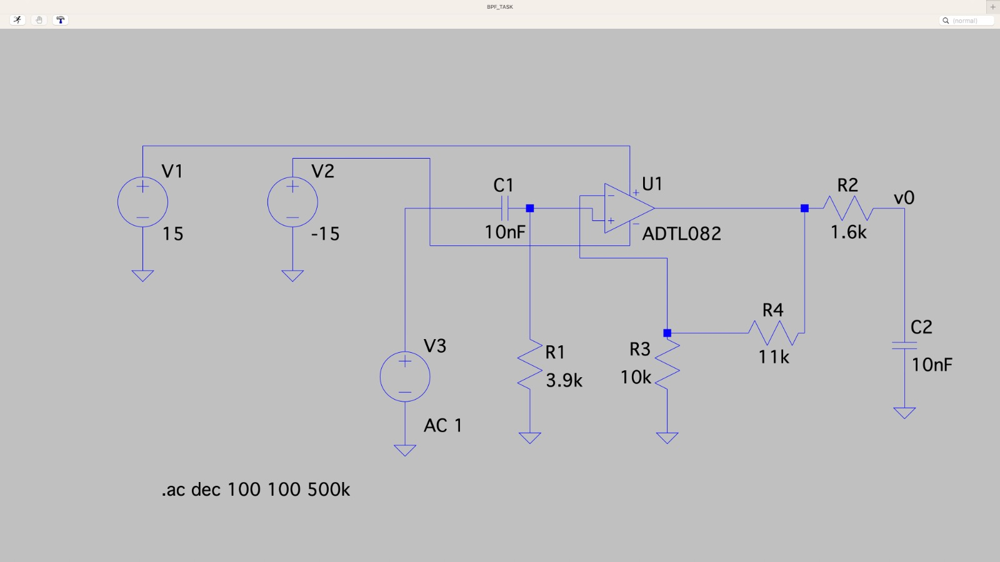

| Component | Value   | Role                                |
| --------- | ------- | ----------------------------------- |
| C1        | 10 nF   | High-pass section                   |
| R1        | 3.9 kΩ  | High-pass section                   |
| U1        | ADTL082 | Op-amp (non-inverting amplifier)    |
| R3        | 10 kΩ   | Sets the gain                       |
| R4        | 11 kΩ   | Sets the gain (feedback)            |
| R2        | 1.6 kΩ  | Low-pass section                    |
| C2        | 10 nF   | Low-pass section                    |
| V1        | +15 V   | Positive supply                     |
| V2        | -15 V   | Negative supply                     |
| V3        | AC 1    | Input signal (1 V for the AC sweep) |

**How it is connected:** the input V3 goes through C1 to the op-amp's non-inverting input, with R1 to ground. R3 and R4 set the amplifier gain. The op-amp's output goes through R2 and then to C2 to ground, and the output v0 is taken across C2.

## 6. Design Calculations

**High-pass (lower) cutoff frequency**

```
fH = 1 / (2 × π × R1 × C1)
   = 1 / (2 × π × 3.9 kΩ × 10 nF)
   ≈ 4.08 kHz
```

**Low-pass (upper) cutoff frequency**

```
fL = 1 / (2 × π × R2 × C2)
   = 1 / (2 × π × 1.6 kΩ × 10 nF)
   ≈ 9.95 kHz
```

Both cutoff frequencies are within the required 4 kHz to 10 kHz range.

**Op-amp gain**

```
Gain = 1 + (R4 / R3)
     = 1 + (11 kΩ / 10 kΩ)
     = 2.1  (which is 6.44 dB)
```

**Centre frequency (where the gain is highest)**

```
f0 = √(fH × fL)
   = √(4.08 kHz × 9.95 kHz)
   ≈ 6.37 kHz
```

**Expected gain at the centre frequency**

The high-pass and low-pass sections each reduce the signal a little at f0. Each one lets through about 0.84 of the signal there:

```
Gain at f0 = 2.1 × 0.842 × 0.842
           ≈ 1.49  (which is about 3.46 dB)
```

## 7. LTspice Simulation

- Analysis: `.ac dec 100 100 500k`, which sweeps from 100 Hz to 500 kHz with 100 points per decade.
- The input source V3 is set to `AC 1`.
- The output measured is `V(v0)`.

## 8. Results

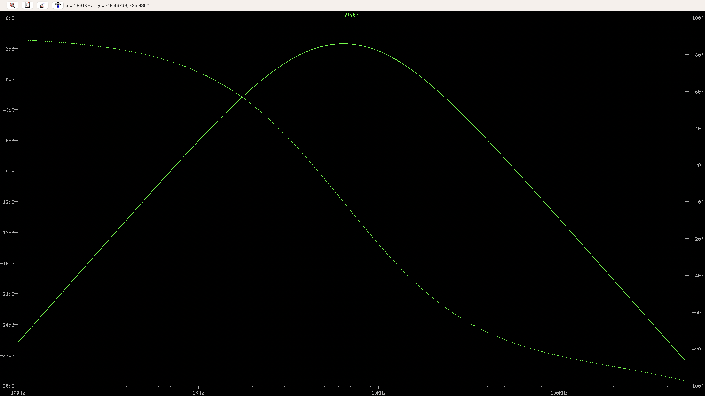

| Quantity                      | Calculated     | Simulated (from graph)      |
| ----------------------------- | -------------- | --------------------------- |
| Lower cutoff (high-pass)      | 4.08 kHz       | Set by R1 and C1            |
| Upper cutoff (low-pass)       | 9.95 kHz       | Set by R2 and C2            |
| Centre frequency              | 6.37 kHz       | ≈ 6.4 kHz                   |
| Peak gain                     | 1.49 (3.46 dB) | ≈ 3.5 dB (about 1.49 times) |
| Phase at the centre frequency | 0°             | ≈ 0°                        |
| Gain at 100 Hz                | -25.8 dB       | ≈ -25.8 dB                  |
| Phase at 100 Hz               | +88°           | ≈ +88°                      |

## 9. Observations

- The gain rises as the frequency increases, reaches its highest point of about +3.5 dB near 6.4 kHz, and then falls again. This is the shape of a band-pass filter.
- The peak gain is about 1.49 times, so the filter meets the "roughly 1.5 times" requirement.
- On both sides of the peak, the gain changes by about 20 dB for every ten times change in frequency. This is expected for first-order RC sections.
- The phase starts near +90° at low frequencies, crosses 0° at the centre frequency, and goes towards -90° at high frequencies.
- The op-amp stage has a gain of 2.1, but the peak gain is only about 1.49. This is because the RC sections reduce the signal slightly, even in the middle of the band.
- At the two design cutoff frequencies (4.08 kHz and 9.95 kHz), the calculated gain is about 2.76 dB, which is about 0.7 dB below the peak.
- Because the two cutoff frequencies are fairly close together, the response is wide. Calculated from the peak, the gain drops by 3 dB at about 2.5 kHz and about 16.5 kHz.

## 10. Conclusion

A second-order active band-pass filter was designed and simulated in LTspice using an ADTL082 op-amp. The high-pass cutoff is 4.08 kHz and the low-pass cutoff is 9.95 kHz, both inside the required 4 kHz to 10 kHz range. The simulated peak gain is about 3.5 dB (about 1.49 times), which meets the target of roughly 1.5 times. The simulation matches the calculations closely.

## 11. References

- Band-pass filters: https://www.youtube.com/watch?v=dmPIydL0lyM
- Op-amps: https://youtu.be/OSCKBmkrH_g?si=pH-DUt8XflFL7zf3


# Task 3: SPICEy Code

**Platform:** LTspice

---

## 1. Aim

To write basic SPICE code for a MOS (CMOS) inverter, a 2-input AND gate and a 2-input OR gate, and to simulate them in LTspice.

## 2. Objectives

- Learn what SPICE is and how a SPICE netlist is written.
- Write SPICE code for a CMOS inverter using one NMOS and one PMOS transistor.
- Write SPICE code for a 2-input AND gate and a 2-input OR gate.
- Run a transient (time) simulation and check each circuit using its waveforms.

## 3. Theory

### 3.1 What is SPICE?

SPICE is a program that simulates electronic circuits. Instead of drawing the circuit, we can describe it in text. This text is called a **netlist**. Each line describes one part and the nodes (connection points) it is connected to. Node `0` always means ground.

### 3.2 SPICE statements used in this task

| Statement    | Meaning                                                 | Example                            |
| ------------ | ------------------------------------------------------- | ---------------------------------- |
| `V...`       | Voltage source                                          | `VDD vdd 0 5`                      |
| `PULSE(...)` | A square-wave (pulse) source                            | `PULSE(0 5 0 1n 1n 5m 10m)`        |
| `M...`       | MOSFET: drain, gate, source, body, model                | `M1 out in 0 0 NMOS`               |
| `B...`       | Behavioural source: its voltage is given by an equation | `BY y 0 V = ...`                   |
| `R...`       | Resistor                                                | `Rload y 0 100k`                   |
| `.model`     | Sets the parameters of a transistor                     | `.model NMOS NMOS (VTO=1 KP=100u)` |
| `.tran`      | Transient (time) analysis                               | `.tran 0 30m 0 10u`                |
| `.end`       | End of the netlist                                      | `.end`                             |
| `*`          | Comment (ignored by SPICE)                              | `* CMOS MOS Inverter`              |

The PULSE source has this format:

`PULSE(V1 V2 TD TR TF TON PERIOD)`

| Value  | Meaning                            |
| ------ | ---------------------------------- |
| V1     | Low voltage                        |
| V2     | High voltage                       |
| TD     | Delay before the first pulse       |
| TR     | Rise time                          |
| TF     | Fall time                          |
| TON    | Time the pulse stays high          |
| PERIOD | Time after which the pulse repeats |

### 3.3 The CMOS inverter

A CMOS inverter uses two transistors:

- The **NMOS** connects the output to ground when the input is **high**.
- The **PMOS** connects the output to the supply (VDD) when the input is **low**.

Only one transistor is ON at a time, so the output is always the opposite of the input. Very little current flows when the input is not changing.

### 3.4 Truth tables

| A   | B   | A AND B | A OR B |
| --- | --- | ------- | ------ |
| 0   | 0   | 0       | 0      |
| 0   | 1   | 0       | 1      |
| 1   | 0   | 0       | 1      |
| 1   | 1   | 1       | 1      |

---

## 4. Part A: CMOS (MOS) Inverter

### 4.1 SPICE Code

```
* CMOS MOS Inverter

VDD vdd 0 5
VIN in 0 PULSE(0 5 0 1n 1n 5m 10m)

M1 out in 0 0 NMOS W=10u L=1u
M2 out in vdd vdd PMOS W=20u L=1u

.model NMOS NMOS (VTO=1 KP=100u)
.model PMOS PMOS (VTO=-1 KP=50u)

.tran 0 30m 0 10u

.end
```

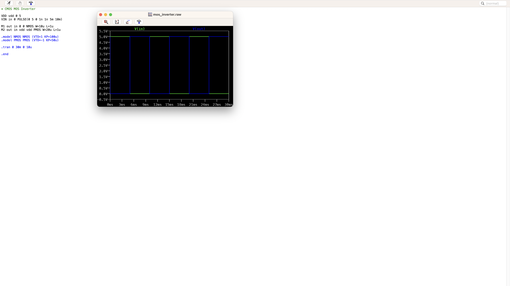

### 4.2 Explanation of the Code

| Line                                 | What it does                                                                                                               |
| ------------------------------------ | -------------------------------------------------------------------------------------------------------------------------- |
| `VDD vdd 0 5`                        | A 5 V supply connected to node `vdd`.                                                                                      |
| `VIN in 0 PULSE(0 5 0 1n 1n 5m 10m)` | The input: a square wave between 0 V and 5 V. Rise and fall take 1 ns, it stays high for 5 ms, and it repeats every 10 ms. |
| `M1 out in 0 0 NMOS W=10u L=1u`      | The NMOS transistor. Drain = `out`, gate = `in`, source and body = ground. Width 10 µm, length 1 µm.                       |
| `M2 out in vdd vdd PMOS W=20u L=1u`  | The PMOS transistor. Drain = `out`, gate = `in`, source and body = `vdd`. Width 20 µm, length 1 µm.                        |
| `.model NMOS NMOS (VTO=1 KP=100u)`   | NMOS threshold voltage is 1 V and its transconductance parameter is 100 µA/V².                                             |
| `.model PMOS PMOS (VTO=-1 KP=50u)`   | PMOS threshold voltage is -1 V and its transconductance parameter is 50 µA/V².                                             |
| `.tran 0 30m 0 10u`                  | Run for 30 ms, start saving data at 0, and use a maximum time step of 10 µs.                                               |
| `.end`                               | End of the netlist.                                                                                                        |

### 4.3 Calculations

**Input signal**

```
Period    = 10 ms
Frequency = 1 / 10 ms = 100 Hz
Duty      = 5 ms / 10 ms = 50 %
Cycles in 30 ms = 30 ms / 10 ms = 3
```

**Transistor strength**

The PMOS has half the KP of the NMOS (50 µA/V² against 100 µA/V²), so it is made twice as wide to balance it.

```
NMOS: KP x (W/L) = 100 µA/V² x (10 µm / 1 µm) = 1000 µA/V² = 1 mA/V²
PMOS: KP x (W/L) =  50 µA/V² x (20 µm / 1 µm) = 1000 µA/V² = 1 mA/V²
```

Both transistors are equally strong.

**Switching threshold (the input voltage where the output flips)**

```
r  = sqrt(βp / βn) = sqrt(1 / 1) = 1

VM = (VTN + r x (VDD + VTP)) / (1 + r)
   = (1 + 1 x (5 + (-1))) / (1 + 1)
   = 5 / 2
   = 2.5 V
```

The inverter switches at the middle of the supply, 2.5 V.

### 4.4 Waveform

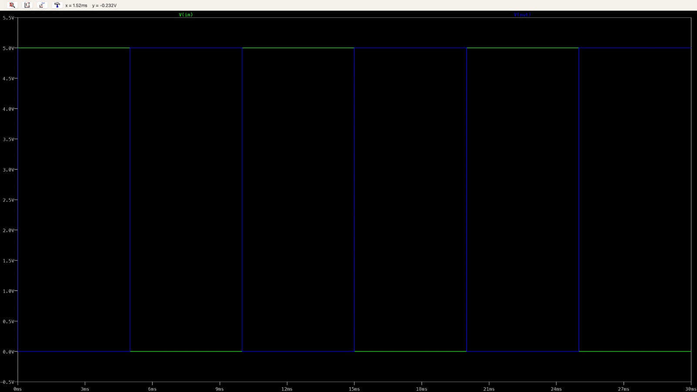

### 4.5 Observations

| Time       | V(in)      | NMOS | PMOS | V(out)     |
| ---------- | ---------- | ---- | ---- | ---------- |
| 0 to 5 ms  | 5 V (high) | ON   | OFF  | 0 V (low)  |
| 5 to 10 ms | 0 V (low)  | OFF  | ON   | 5 V (high) |

- The output is always the opposite of the input, so the circuit works as an inverter (a NOT gate).
- The output swings fully between 0 V and 5 V.
- The pattern repeats 3 times in 30 ms, matching the 10 ms period.

---

## 5. Part B: 2-Input AND Gate

### 5.1 SPICE Code

```
* MARVEL SPICEy Code - 2-Input AND Gate
* Final Working SPICE Netlist

* --- Inputs A and B ---
VA a 0 PULSE(0 5 0 10u 10u 20m 40m)
VB b 0 PULSE(0 5 0 10u 10u 10m 20m)

* --- 5V Output AND Logic ---
BY y 0 V = if((V(a) > 2.5) & (V(b) > 2.5), 5, 0)

* --- Load Resistor ---
Rload y 0 100k

* --- Simulation Command ---
.tran 0 40m 0 10u

.end
```


\_

### 5.2 Explanation of the Code

| Line                                               | What it does                                                                     |
| -------------------------------------------------- | -------------------------------------------------------------------------------- |
| `VA a 0 PULSE(0 5 0 10u 10u 20m 40m)`              | Input A: 0 V to 5 V, 10 µs rise and fall, high for 20 ms, repeats every 40 ms.   |
| `VB b 0 PULSE(0 5 0 10u 10u 10m 20m)`              | Input B: 0 V to 5 V, 10 µs rise and fall, high for 10 ms, repeats every 20 ms.   |
| `BY y 0 V = if((V(a) > 2.5) & (V(b) > 2.5), 5, 0)` | Output y is 5 V when A and B are both above 2.5 V (logic 1). Otherwise y is 0 V. |
| `Rload y 0 100k`                                   | A 100 kΩ load resistor from the output to ground.                                |
| `.tran 0 40m 0 10u`                                | Run for 40 ms with a maximum step of 10 µs.                                      |

**Note:** the gate is written as a behavioural model. The `if(...)` equation produces the logic function directly instead of building the gate from transistors. 2.5 V is used as the dividing line between logic 0 and logic 1 because it is half of 5 V.

### 5.3 Calculations

```
Input A: Period = 40 ms, Frequency = 1 / 40 ms = 25 Hz
Input B: Period = 20 ms, Frequency = 1 / 20 ms = 50 Hz

Load current when output is high = V / R = 5 V / 100 kΩ = 50 µA
```

B changes twice as fast as A, so all four input combinations (00, 01, 10, 11) appear within the 40 ms simulation.

### 5.4 Waveform

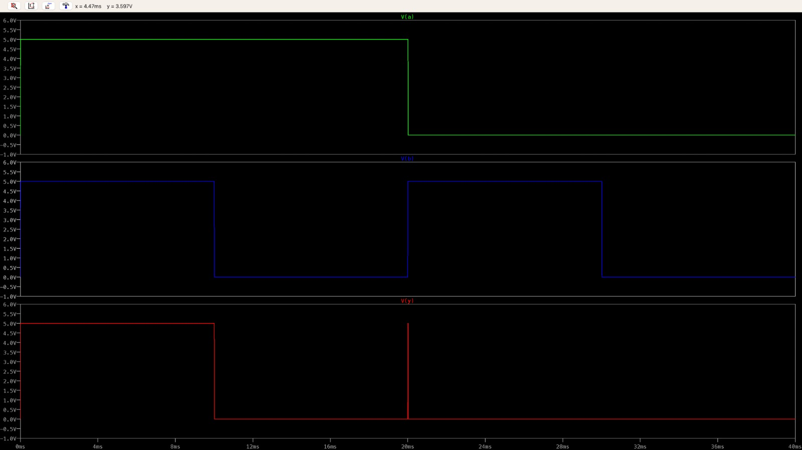

### 5.5 Observations

| Time        | A   | B   | Expected Y | Y from graph |
| ----------- | --- | --- | ---------- | ------------ |
| 0 to 10 ms  | 1   | 1   | 1          | 5 V          |
| 10 to 20 ms | 1   | 0   | 0          | 0 V          |
| 20 to 30 ms | 0   | 1   | 0          | 0 V          |
| 30 to 40 ms | 0   | 0   | 0          | 0 V          |

- The output is high only when A and B are both high, which is the AND function.
- **Spike at 20 ms:** the output shows a very thin spike at 20 ms. At that moment A is falling while B is rising at nearly the same time. Each edge takes 10 µs, so for about 10 µs both inputs are above 2.5 V and the output briefly goes high. This is a short glitch caused by the timing of the inputs, not a fault in the gate. The output is correct (0 V) for the rest of the 20 to 30 ms window.

---

## 6. Part C: 2-Input OR Gate

### 6.1 SPICE Code

```
* MARVEL SPICEy Code - 2-Input OR Gate
* Final Working SPICE Netlist

* --- Inputs A and B ---
VA a 0 PULSE(0 5 0 10u 10u 20m 40m)
VB b 0 PULSE(0 5 0 10u 10u 10m 20m)

* --- 5V Output OR Logic ---
BY y 0 V = if((V(a) > 2.5) | (V(b) > 2.5), 5, 0)

* --- Load Resistor ---
Rload y 0 100k

* --- Simulation Command ---
.tran 0 40m 0 10u

.end
```


### 6.2 Explanation of the Code

The code is the same as the AND gate, with two changes:

- The `&` (AND) sign is replaced by `|` (OR), so output y is 5 V when **A or B (or both)** is above 2.5 V.
- The inputs A and B use the same pulse settings, so the same four input combinations appear.

### 6.3 Waveform

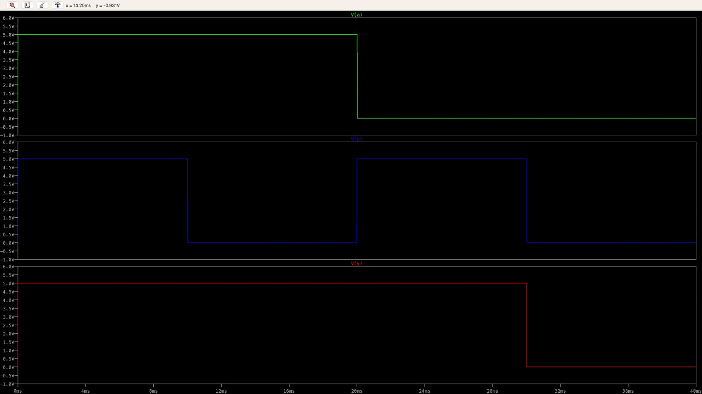

### 6.4 Observations

| Time        | A   | B   | Expected Y | Y from graph |
| ----------- | --- | --- | ---------- | ------------ |
| 0 to 10 ms  | 1   | 1   | 1          | 5 V          |
| 10 to 20 ms | 1   | 0   | 1          | 5 V          |
| 20 to 30 ms | 0   | 1   | 1          | 5 V          |
| 30 to 40 ms | 0   | 0   | 0          | 0 V          |

- The output is high whenever at least one input is high, and low only when both inputs are low (after 30 ms). This is the OR function.
- There is no spike at 20 ms. When A falls and B rises, at least one of them is always high, so the OR output stays high.

---

## 7. Summary of Results

| Circuit       | Built with                | Expected behaviour                   | Result                                 |
| ------------- | ------------------------- | ------------------------------------ | -------------------------------------- |
| CMOS inverter | NMOS and PMOS transistors | Output is the opposite of the input  | Matches                                |
| AND gate      | Behavioural source        | High only when A and B are both high | Matches (with a 10 µs glitch at 20 ms) |
| OR gate       | Behavioural source        | Low only when A and B are both low   | Matches                                |

ed.]

## 8. Conclusion

SPICE code was written and simulated in LTspice for a CMOS inverter, a 2-input AND gate and a 2-input OR gate. The inverter, built from an NMOS and a PMOS transistor, gave an output that is always the opposite of its input. The AND and OR gates, written as behavioural models, followed their truth tables for all four input combinations. This task showed how a circuit can be described in text and checked with a simulation.

## 9. References

- Introduction to SPICE: https://www.youtube.com/watch?v=1kGkf3vLnCc


# Task 4: From Low to Woah!

**Platform:** LTspice

---

## 1. Aim

To build a voltage multiplier using capacitor pumps driven by a 555 timer IC. First pump 9 V up to about 18 V, then cascade a second pump to reach about 27 V.

## 2. Objectives

- Learn how a 555 timer works as an oscillator (astable mode).
- Learn how a capacitor pump (charge pump) raises a voltage.
- Cascade two pump stages to get a higher voltage.
- Simulate the circuit in LTspice and compare the results with the calculations.

## 3. Theory

### 3.1 The 555 timer as an oscillator

In astable mode the 555 timer produces a continuous square wave at its output with no input signal. The timing is set by R1, R2 and C1:

```
t_high = 0.693 x (R1 + R2) x C1
t_low  = 0.693 x R2 x C1
T      = t_high + t_low = 0.693 x (R1 + 2 x R2) x C1
f      = 1 / T
Duty   = t_high / T
```

### 3.2 The capacitor pump 

A capacitor pump uses the square wave from the 555 to move charge and stack voltages on top of each other:

1. **Output LOW (0 V):** a diode connected to the supply charges the pump capacitor to about the supply voltage (minus one diode drop).
2. **Output HIGH (about the supply voltage):** the output pushes up on one side of the capacitor. The other side rises by the same amount, so it sits at about **twice** the supply voltage.
3. A second diode passes this raised voltage into a storage capacitor, which holds it steady.

```
V_out (ideal) = 2 x Vcc        (one pump stage)
V_out (ideal) = 3 x Vcc        (two stages cascaded)
```

In a real circuit, each diode drops about 0.5 to 0.7 V and the 555 output does not swing fully to the supply, so the real voltage is a little lower than the ideal one.

## 4. Specifications

| Parameter                 | Requirement          |
| ------------------------- | -------------------- |
| Supply                    | 9 V                  |
| Stage 1 output            | About 18 V (2 x 9 V) |
| Stage 2 output (cascaded) | About 27 V (3 x 9 V) |
| Oscillator                | NE555 timer, astable |
| Software                  | LTspice              |

## 5. Circuit and Components

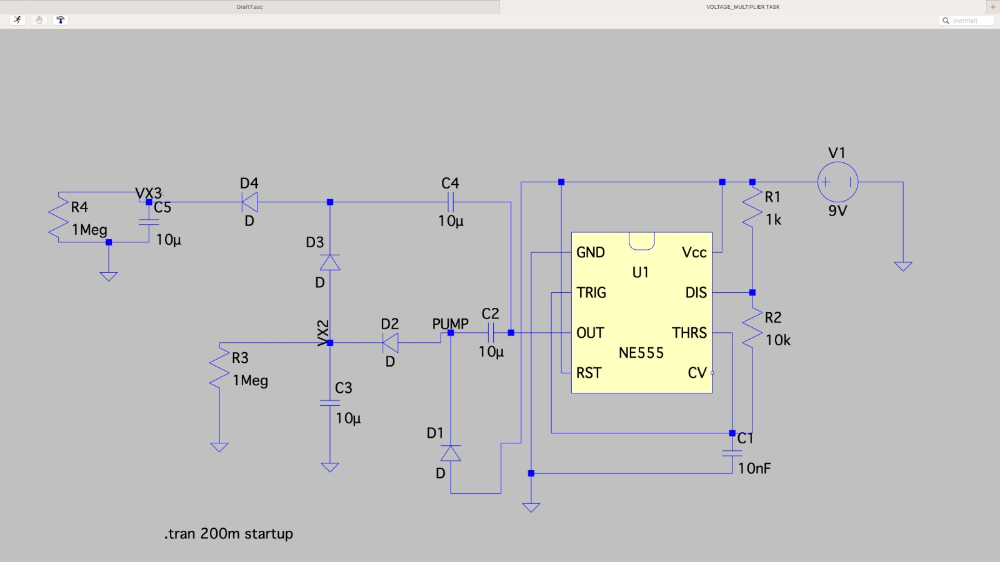

| Component | Value | Role                                                |
| --------- | ----- | --------------------------------------------------- |
| V1        | 9 V   | Supply                                              |
| U1        | NE555 | Oscillator (astable mode)                           |
| R1        | 1 kΩ  | 555 timing (supply to discharge pin)                |
| R2        | 10 kΩ | 555 timing (discharge pin to threshold and trigger) |
| C1        | 10 nF | 555 timing capacitor                                |
| C2        | 10 µF | Pump capacitor, stage 1                             |
| D1        | Diode | Charges C2 from the supply when the output is low   |
| D2        | Diode | Passes the pumped voltage to C3                     |
| C3        | 10 µF | Storage capacitor, stage 1 (node VX2)               |
| R3        | 1 MΩ  | Load, stage 1                                       |
| C4        | 10 µF | Pump capacitor, stage 2                             |
| D3        | Diode | Charges C4 from VX2 when the output is low          |
| D4        | Diode | Passes the pumped voltage to C5                     |
| C5        | 10 µF | Storage capacitor, stage 2 (node VX3)               |
| R4        | 1 MΩ  | Load, stage 2                                       |

**How it is connected:**

- The 555 is wired as an astable oscillator. The trigger and threshold pins are joined, R1 and R2 connect from the supply to the discharge pin and on to C1, and the reset pin is tied to the supply.
- The 555 output drives both pump capacitors, C2 and C4.
- **Stage 1:** D1 connects the supply to the PUMP node. C2 sits between the 555 output and PUMP. D2 passes PUMP to VX2, where C3 and R3 are connected to ground.
- **Stage 2:** D3 connects VX2 to the node at one side of C4. C4 sits between the 555 output and that node. D4 passes it on to VX3, where C5 and R4 are connected to ground.
- Because stage 2 starts from VX2 (about 2 x the supply) and adds another supply voltage on top, it reaches about 3 x the supply.
- The simulation command is `.tran 200m startup`.

## 6. Design Calculations

**555 oscillator**

```
t_high = 0.693 x (R1 + R2) x C1
       = 0.693 x (1 kΩ + 10 kΩ) x 10 nF
       = 0.693 x 11 kΩ x 10 nF
       ≈ 76.2 µs

t_low  = 0.693 x R2 x C1
       = 0.693 x 10 kΩ x 10 nF
       ≈ 69.3 µs

T      = t_high + t_low = 76.2 µs + 69.3 µs ≈ 145.5 µs

f      = 1 / T = 1 / 145.5 µs ≈ 6.87 kHz

Duty   = t_high / T = 76.2 / 145.5 ≈ 52.4 %
```

**Ideal output voltages**

```
Stage 1:  V(VX2) = 2 x Vcc = 2 x 9 V = 18 V
Stage 2:  V(VX3) = 3 x Vcc = 3 x 9 V = 27 V
```

**Load currents** (at the simulated voltages)

```
Stage 1:  I = V / R3 = 16.8 V / 1 MΩ ≈ 16.8 µA
Stage 2:  I = V / R4 = 24.7 V / 1 MΩ ≈ 24.7 µA
```

These currents are very small, so the pumps are lightly loaded and the output voltage stays steady.

**Voltage gain (from the simulation)**

```
Stage 1:  16.8 V / 9 V ≈ 1.87 times
Stage 2:  24.7 V / 9 V ≈ 2.74 times
```

**Percentage of the ideal value reached**

```
Stage 1:  16.8 V / 18 V ≈ 93 %
Stage 2:  24.7 V / 27 V ≈ 91 %
```

**Voltage lost compared with the ideal value**

```
Stage 1:  18 V - 16.8 V ≈ 1.2 V
Stage 2:  27 V - 24.7 V ≈ 2.3 V

Added by the second stage = 24.7 V - 16.8 V ≈ 7.9 V   (ideal: 9 V)
```

## 7. LTspice Simulation

- Analysis: `.tran 200m startup`, which runs for 200 ms.
- The `startup` option makes LTspice start with the supply off and then ramp it up. This helps oscillator circuits like the 555 start properly.
- Signals plotted: V(vx2) for stage 1 and V(vx3) for stage 2.

## 8. Results

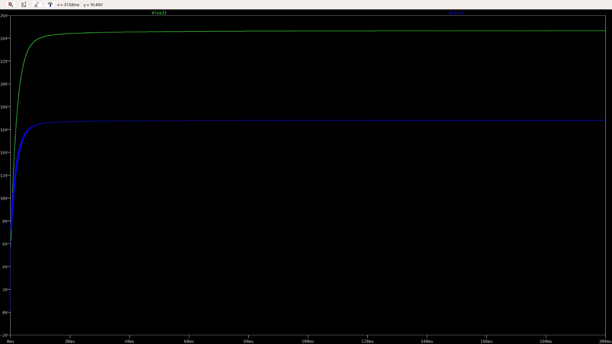

| Quantity              | Ideal / calculated | Simulated (from graph) |
| --------------------- | ------------------ | ---------------------- |
| Supply voltage        | 9 V                | 9 V                    |
| Stage 1 output V(vx2) | 18 V               | ≈ 16.8 V               |
| Stage 2 output V(vx3) | 27 V               | ≈ 24.7 V               |
| 555 frequency         | 6.87 kHz           | Not measured           |
| Time to settle        | Not calculated     | About 20 to 40 ms      |

## 9. Observations

- Both outputs rise quickly in the first few milliseconds and then level off. They stay flat for the rest of the 200 ms.
- The stage 1 voltage (blue) settles at about 16.8 V, which is close to double the 9 V supply.
- The stage 2 voltage (green) settles at about 24.7 V, which is close to triple the supply.
- The blue line looks thicker while it is rising. This is because VX2 goes up a little with every pulse of the 555, so the line shows the individual pumping steps.
- Each stage gives slightly less than the ideal value. Every stage has two diodes in the path, and each diode drops some voltage. The 555 output also does not reach the full supply voltage.
- Cascading a second stage added about 7.9 V on top of the first stage, instead of the ideal 9 V. This shows that each extra stage loses some voltage.
- The 1 MΩ loads draw very little current (about 17 to 25 µA), so the 10 µF capacitors hold the voltage steady once it has settled.
- The CV pin of the 555 is left unconnected in this circuit.

## 10. Conclusion

A voltage multiplier was built in LTspice using a 555 timer and two capacitor pump stages. The 555, running at about 6.87 kHz, drives the pumps. The first stage raised 9 V to about 16.8 V, close to the ideal 18 V. The cascaded second stage raised it further to about 24.7 V, close to the ideal 27 V. The small difference from the ideal values comes mainly from diode voltage drops and the 555 output not reaching the full supply voltage. The task shows how a pulsed signal and capacitors can raise a voltage without a transformer.

## 11. References

- 555 timer: https://www.youtube.com/watch?v=EGmreVQ-yNM


# Task 5: The Power Shuffle: Buck-Boost Edition


**Platform:** LTspice

---

## 1. Aim

To learn about DC-DC converters, and to build and simulate two of them in LTspice:

- A **boost converter** that steps 1.5 V up to 5 V.
- A **buck converter** that steps 12 V down to 5 V.

## 2. Objectives

- Understand what a DC-DC converter is and why it is used.
- Learn how a buck (step-down) converter and a boost (step-up) converter work.
- Calculate the duty cycle and the main values for each converter.
- Simulate both converters and compare the results with the calculations.

## 3. Theory

### 3.1 What is a DC-DC converter?

A DC-DC converter changes one DC voltage into a different DC voltage. It does this by switching a transistor ON and OFF very quickly, and using an inductor and a capacitor to store the energy and smooth the output. Because the switch is either fully ON or fully OFF, very little energy is wasted as heat.

### 3.2 Main parts

| Part | Job |
|---|---|
| Switch (MOSFET) | Turns the current ON and OFF very fast |
| Inductor | Stores energy as a magnetic field while current flows |
| Diode | Lets the inductor current flow in one direction only |
| Capacitor | Smooths the output voltage |
| Load (resistor) | The device being powered |

### 3.3 Duty cycle

The duty cycle (D) is the fraction of each switching period that the switch is ON.

```
D = t_on / T          T = 1 / f
```

### 3.4 Buck converter (step-down)

- **Switch ON:** current flows from the supply, through the inductor, to the load. The inductor stores energy.
- **Switch OFF:** the inductor keeps the current flowing through the diode (the freewheeling diode), so the load keeps getting power.
- The output is always **lower** than the input:

```
Vout = D x Vin
```

### 3.5 Boost converter (step-up)

- **Switch ON:** the inductor is connected across the input and its current rises, storing energy. The diode blocks, so the capacitor supplies the load.
- **Switch OFF:** the inductor current keeps flowing, through the diode, into the capacitor and the load. The inductor's voltage adds to the input voltage, so the output is **higher**.
- The output is always **higher** than the input:

```
Vout = Vin / (1 - D)
```

## 4. Specifications

| Converter | Input | Output |
|---|---|---|
| Boost | 1.5 V | 5 V |
| Buck | 12 V | 5 V |

Software: LTspice.

---

## 5. Part A: Boost Converter (1.5 V to 5 V)

### 5.1 Circuit

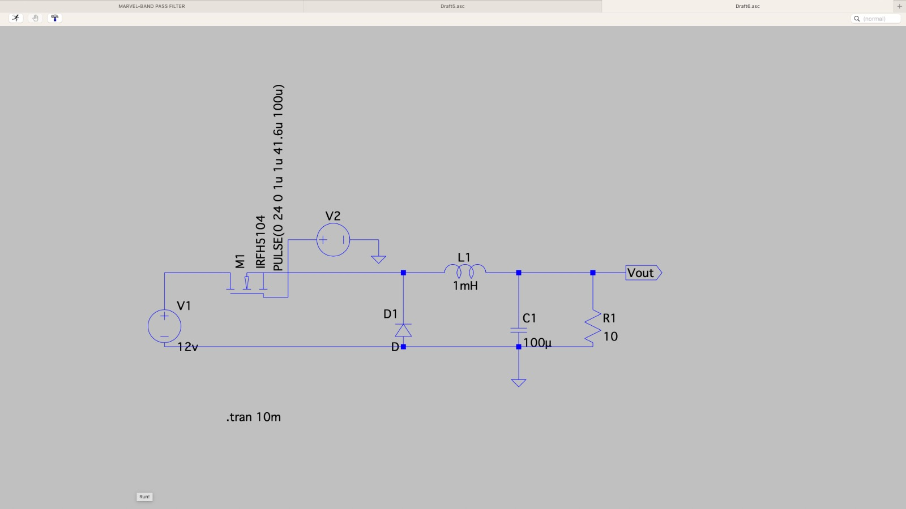


| Component | Value | Role |
|---|---|---|
| V1 | 1.5 V | Input supply |
| Switch (MOSFET) | [name] | Switches the inductor current ON and OFF |
| Gate pulse source | [pulse settings] | Drives the switch |
| L1 | [value] | Stores energy |
| D1 | [name] | Passes the inductor current to the output |
| C1 | [value] | Smooths the output |
| R1 (load) | [value] | Load |


### 5.2 Design Calculations

**Duty cycle needed**

```
Vout = Vin / (1 - D)

D = 1 - (Vin / Vout)
  = 1 - (1.5 V / 5 V)
  = 1 - 0.3
  = 0.7        (70 %)
```

**Check**

```
Vout = 1.5 V / (1 - 0.7) = 1.5 V / 0.3 = 5 V
```

**Switching period and on-time**

```
T    = 1 / f = 1 / [switching frequency] = [value]
t_on = D x T = 0.7 x [value] = [value]
```

**Inductor current ripple**

```
Delta I_L = (Vin x t_on) / L = (1.5 V x [t_on]) / [L] = [value] A
```

A real converter loses a little voltage in the diode and the switch, so the duty cycle needed in practice is slightly higher than the ideal 70 %.

### 5.3 Simulation

- Analysis: transient simulation from 0 to 5 ms.
- Signal plotted: V(n003), the converter output.

### 5.4 Results

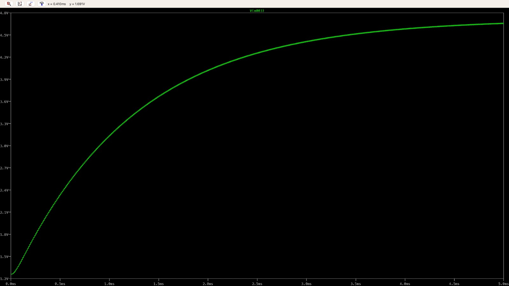


| Quantity | Value |
|---|---|
| Input voltage | 1.5 V |
| Target output | 5 V |
| Output at the start | ≈ 1.26 V |
| Time to pass 4.5 V | about 3.5 ms |
| Output at 5 ms | ≈ 4.66 V |
| Percentage of the target at 5 ms | ≈ 93 % |

### 5.5 Observations

- The output starts at about 1.26 V. This is close to the 1.5 V input minus a small diode drop, because the output capacitor is already charged through the inductor and the diode before switching begins.
- The output then rises quickly at first and more slowly later, reaching about 4.66 V at 5 ms.
- The output is still rising slowly at the end of the simulation, so it is heading towards the 5 V target but has not fully reached it. A longer simulation would show the final value.
- The curve is made of tiny steps, one for each switching cycle. Each cycle pumps a little more energy into the output capacitor.
- The output (about 4.7 V) is much higher than the 1.5 V input, so the circuit works as a step-up converter.

---

## 6. Part B: Buck Converter (12 V to 5 V)

### 6.1 Circuit


| Component | Value | Role |
|---|---|---|
| V1 | 12 V | Input supply |
| M1 | IRFH5104 (N-channel MOSFET) | Switch |
| V2 | PULSE(0 24 0 1u 1u 41.6u 100u) | Gate drive for M1 |
| D1 | Diode | Freewheeling diode |
| L1 | 1 mH | Stores energy |
| C1 | 100 µF | Smooths the output |
| R1 | 10 Ω | Load |
| Simulation | `.tran 10m` | Runs for 10 ms |

**How it is connected:**

- M1 sits between the 12 V supply and the switching node.
- D1 connects from ground to the switching node.
- L1 connects from the switching node to the output.
- C1 and the load R1 connect from the output to ground.

**Gate drive settings (PULSE):**

| Setting | Value |
|---|---|
| Low voltage | 0 V |
| High voltage | 24 V |
| Delay | 0 |
| Rise time | 1 µs |
| Fall time | 1 µs |
| On-time | 41.6 µs |
| Period | 100 µs (10 kHz) |

The gate is driven up to 24 V because M1 is on the high side. When it is ON its source sits near 12 V, so a 24 V gate gives a gate-to-source voltage of about 12 V, enough to switch it fully ON.

### 6.2 Design Calculations

**Duty cycle and timing**

```
D    = Vout / Vin = 5 V / 12 V ≈ 0.4167     (41.7 %)
T    = 1 / f = 1 / 10 kHz = 100 µs
t_on = D x T = 0.4167 x 100 µs ≈ 41.67 µs    (41.6 µs used)
```

**Load current and power**

```
Iout = Vout / R = 5 V / 10 Ω = 0.5 A
P    = Vout^2 / R = 25 / 10 = 2.5 W
```

**Inductor current ripple**

```
Delta I_L = (Vin - Vout) x t_on / L
          = (12 V - 5 V) x 41.6 µs / 1 mH
          ≈ 0.29 A   (peak to peak)

I_L(max) = 0.5 A + 0.29 A / 2 ≈ 0.65 A
I_L(min) = 0.5 A - 0.29 A / 2 ≈ 0.35 A
```

The minimum inductor current stays above 0 A, so the inductor current never stops flowing (continuous conduction).

**Output voltage ripple**

```
Delta Vout = Delta I_L / (8 x f x C)
           = 0.2912 A / (8 x 10 kHz x 100 µF)
           = 0.2912 / 8
           ≈ 0.036 V   (about 36 mV)
```

**Natural frequency of the LC filter**

```
f0 = 1 / (2 x π x sqrt(L x C))
   = 1 / (2 x π x sqrt(1 mH x 100 µF))
   ≈ 503 Hz       (period ≈ 2 ms)
```

This is the frequency at which the output tends to ring when the converter starts up.

### 6.3 Simulation

- Analysis: `.tran 10m`, which runs for 10 ms.
- V(vout) (green) is the output voltage.
- V(n003) (blue) is the switching node between M1, D1 and L1.

### 6.4 Results

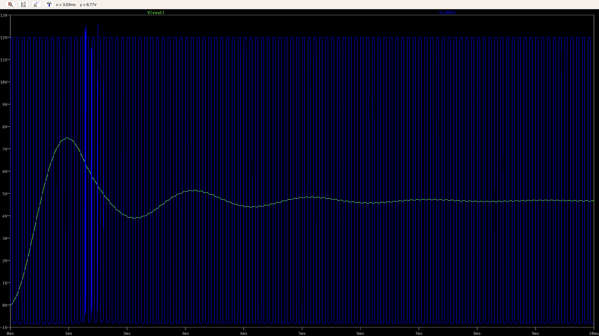

| Quantity | Calculated | Simulated (from graph) |
|---|---|---|
| Final output voltage | 5 V | ≈ 4.7 V |
| Percentage of the target | 100 % | ≈ 94 % |
| Output current (Vout / 10 Ω) | 0.5 A | ≈ 0.47 A |
| Switching node, switch ON | 12 V | ≈ 12 V |
| Switching node, switch OFF | 0 V | ≈ -0.8 V |
| Start-up peak | Not calculated | ≈ 7.5 V at about 1 ms |
| Lowest point after the peak | Not calculated | ≈ 3.9 V at about 2.1 ms |
| Ringing period | ≈ 2 ms | ≈ 2 ms (peaks at about 1 ms and 3.1 ms) |
| Time to settle | Not calculated | about 6 to 8 ms |

**Rough check using the diode drop**

The switch node sits at about -0.8 V while the switch is OFF, which is the voltage drop across D1. The real on-time is slightly longer than 41.6 µs because the rise and fall each take 1 µs (about 42.6 µs, so D is about 0.426).

```
Vout ≈ D x Vin + (1 - D) x (-0.8 V)
     ≈ 0.426 x 12 V + 0.574 x (-0.8 V)
     ≈ 5.11 V - 0.46 V
     ≈ 4.65 V
```

This is close to the simulated value of about 4.7 V.

### 6.5 Observations

- The blue trace is a square wave that switches between about 12 V and about -0.8 V. It repeats every 100 µs, which shows the MOSFET switching at 10 kHz. The -0.8 V is the drop across the diode while the MOSFET is OFF.
- The green output starts at 0 V and rises quickly. It overshoots to about 7.5 V, which is higher than the final value. It then falls to about 3.9 V and rings up and down, with the ringing getting smaller each time.
- The ringing repeats about every 2 ms, which matches the calculated natural frequency of the L and C (about 503 Hz). The 10 Ω load damps it out.
- The output settles at about 4.7 V after about 6 to 8 ms. This is close to the 5 V target but about 0.3 V lower.
- The small shortfall comes mainly from the diode drop of about 0.8 V during the OFF time, which lowers the average voltage at the switch node.
- A few short spikes appear on the blue trace around 1.3 to 1.5 ms, while the output is still overshooting. They do not appear later, once the output has settled.
- After settling, the ripple on the output is small. The calculated ripple is about 36 mV.
- The output (about 4.7 V) is lower than the 12 V input, so the circuit works as a step-down converter.

---

## 7. Summary of Results

| Converter | Input | Target | Simulated output | Result |
|---|---|---|---|---|
| Boost | 1.5 V | 5 V | ≈ 4.66 V at 5 ms (still rising) | Close to the target |
| Buck | 12 V | 5 V | ≈ 4.7 V (settled) | Close to the target |


## 8. Conclusion

A boost converter (1.5 V to 5 V) and a buck converter (12 V to 5 V) were simulated in LTspice. The boost converter raised the output from about 1.26 V to about 4.66 V in 5 ms and was still rising towards 5 V. The buck converter, running at 10 kHz with a duty cycle of about 41.6 %, settled at about 4.7 V after a start-up overshoot that matches the natural frequency of its LC filter. The small differences from the 5 V targets come from real-world effects such as the diode voltage drop, and for the boost converter from the simulation ending while the output was still rising. This task showed how switching a transistor and storing energy in an inductor can raise or lower a DC voltage efficiently.

## 9. References

- What are DC-DC converters: https://www.circuitbasics.com/what-are-dc-dc-converters/


# Task 6: 4 Bits to Rule Them All

**Platform:** CircuitVerse

---

## 1. Aim

To design and implement a 4-bit Arithmetic Logic Unit (ALU) using CircuitVerse that performs arithmetic operations such as addition and subtraction using 2's complement, along with logical operations such as AND, OR and XOR. The ALU uses control signals to select the desired operation and display the corresponding output. Bitwise inversion (NOT) is also included as an additional feature.

## 2. Objectives

- Design a 4-bit adder with appropriate carry propagation.
- Implement subtraction using the 2's complement method.
- Implement 4-bit AND, OR and XOR logical operations.
- Implement bitwise NOT to invert the input bits.
- Design a control unit to select the desired operation.
- Use multiplexers to route the selected operation to the output.
- Display the ALU result and applicable status flags.

## 3. Tools and Resources Used

| Item                  | Details                                                                  |
| --------------------- | ------------------------------------------------------------------------ |
| Platform              | CircuitVerse                                                             |
| Software              | CircuitVerse online digital logic simulator                              |
| Inputs                | Two 4-bit binary operands, A and B                                       |
| Arithmetic operations | Addition and subtraction                                                 |
| Logical operations    | AND, OR, XOR and NOT                                                     |
| Circuit components    | Logic gates, subcircuits, multiplexers, input pins and output indicators |
| Output                | Selected ALU result and status indicators                                |

---

## 4. Theory

### 4.1 Arithmetic Logic Unit (ALU)

An Arithmetic Logic Unit is a combinational digital circuit that performs arithmetic and logical operations on binary data. It is an important component of a processor because it performs calculations and bitwise operations required during instruction execution.

A 4-bit ALU operates on two 4-bit binary inputs, A and B. The circuit calculates the results of different operations and uses control signals to select the required result for the output.

### 4.2 Binary Addition

Binary addition is performed bit by bit, starting from the least significant bit. A full adder accepts two input bits and a carry input, producing a sum bit and a carry output.

The equations for a full adder are:

- **Sum:** S = A XOR B XOR Cin
- **Carry-out:** Cout = (A AND B) OR (Cin AND (A XOR B))

Here, `Cin` represents the carry input and `Cout` represents the carry output.

Four full adders can be connected in series to form a 4-bit ripple-carry adder.

### 4.3 Subtraction Using 2's Complement

Subtraction can be performed using the following identity:

**A − B = A + (2's complement of B)**

The 2's complement of B is obtained by inverting every bit of B and adding 1.

Therefore:

**A − B = A + NOT(B) + 1**

This method allows subtraction to be implemented using adder logic.

### 4.4 Logical Operations

The ALU supports bitwise logical operations on the corresponding bits of A and B.

| Operation | Expression | Description                                  |
| --------- | ---------- | -------------------------------------------- |
| AND       | A AND B    | Output is 1 when both input bits are 1       |
| OR        | A OR B     | Output is 1 when at least one input bit is 1 |
| XOR       | A XOR B    | Output is 1 when the input bits differ       |
| NOT       | NOT A      | Inverts each bit of A                        |

### 4.5 Control Unit and Multiplexers

The control unit determines which operation is selected. A multiplexer (MUX) selects one input from several available inputs based on its selection signals.

The outputs of the arithmetic and logical subcircuits are connected to the selection network. The control inputs determine which operation result is passed to the final ALU output.

### 4.6 Status Flags

Status flags provide additional information about the result.

- **Carry flag (C):** Indicates the carry-out of an arithmetic operation.
- **Overflow flag (V):** Indicates signed arithmetic overflow when the corresponding overflow logic is implemented.
- **Zero flag (Z):** Indicates that the selected output is zero.

The exact behaviour of these flags depends on the circuit connections and should be verified through testing.

---

## 5. Procedure

### 5.1 Designing the 4-Bit Adder

1. Created a subcircuit for the 4-bit adder.
2. Used full-adder logic to process the corresponding bits of inputs A and B.
3. Connected the carry output of each stage to the carry input of the next stage.
4. Combined the four sum outputs to produce the 4-bit result.
5. Connected the result and carry signals to the appropriate outputs.

### 5.2 Implementing Subtraction

1. Created a separate arithmetic path for subtraction.
2. Used the 2's complement principle to calculate A − B.
3. Inverted the appropriate B input bits.
4. Added 1 through the initial carry input.
5. Connected the difference output to the operation-selection network.

### 5.3 Implementing Logical Operations

Created separate 4-bit subcircuits for the following operations:

- **AND:** Performs bitwise AND on A and B.
- **OR:** Performs bitwise OR on A and B.
- **XOR:** Performs bitwise exclusive OR on A and B.
- **NOT:** Inverts the selected 4-bit input.

Each logical subcircuit produces a 4-bit output.

### 5.4 Designing the Control Unit

1. Added operation-selection inputs.
2. Connected the outputs of the arithmetic and logical subcircuits to the multiplexer network.
3. Assigned selection inputs to choose the required operation.
4. Connected the selected result to the final ALU output.
5. Added output indicators for the result and applicable status signals.

### 5.5 Integrating the ALU

1. Combined the arithmetic and logical subcircuits in the main CircuitVerse project.
2. Connected the common operands A and B to the required subcircuits.
3. Connected the control signals to the selection network.
4. Connected the selected output to the ALU output indicator.
5. Added status-output connections for observing the relevant flags.

### 5.6 Testing the Circuit

The following test cases can be used to verify the intended operation of the ALU.

| Operation   | Input A | Input B      | Expected Result |
| ----------- | ------- | ------------ | --------------- |
| Addition    | 0011    | 0001         | 0100            |
| Subtraction | 0101    | 0010         | 0011            |
| AND         | 1100    | 1010         | 1000            |
| OR          | 1100    | 1010         | 1110            |
| XOR         | 1100    | 1010         | 0110            |
| NOT A       | 0011    | Not required | 1100            |

---

## 6. Circuit Implementation

The main circuit integrates the arithmetic and logical subcircuits with multiplexers and output indicators. The inputs are distributed to the required operation blocks, and the control signals determine which result reaches the final output.

### 6.1 Circuit Diagram

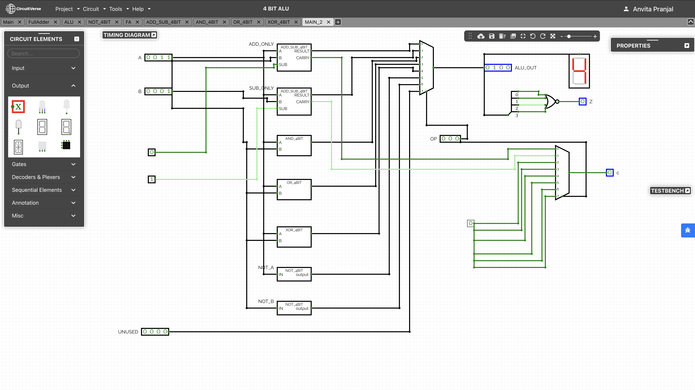

---

## 7. Results

- Designed the main 4-bit ALU circuit in CircuitVerse.
- Integrated separate arithmetic and logical operation blocks.
- Used a multiplexer-based selection network to route the selected result.
- Included bitwise inversion as an additional operation.
- Provided output indicators for observing the selected result and status signals.
- Identified test cases for verifying arithmetic and logical operations.

## 8. Conclusion

This task demonstrates the design of a 4-bit Arithmetic Logic Unit using CircuitVerse. The circuit combines arithmetic operations, including addition and subtraction using 2's complement, with logical operations such as AND, OR, XOR and NOT. It also demonstrates how control signals and multiplexers can be used to select between different computational results.

## 10. References

1. CircuitVerse — Digital Logic Circuit Simulator: https://circuitverse.org/
2. GeeksforGeeks — 2's Complement: https://www.geeksforgeeks.org/dsa/2s-complement/
3. GeeksforGeeks — Arithmetic Logic Unit (ALU): https://www.geeksforgeeks.org/computer-organization-architecture/arithmetic-logic-unit-alu/


# TASK 7- PCB REVOLUTION NE555 Astable Multivibrator LED Flasher PCB

## 1. Project Overview & Objectives

### 1.1 Project Overview

The NE555 Astable Multivibrator LED Flasher is an electronic circuit designed to generate a continuous sequence of HIGH and LOW output pulses using an NE555 timer integrated circuit.

The circuit operates in astable mode, in which the output continuously oscillates without requiring an external trigger for every cycle. The charging and discharging of a timing capacitor determine the oscillation frequency and duty cycle.

This project involves designing the circuit schematic, assigning component footprints, creating a PCB layout, routing electrical connections, applying copper fills, and verifying the design using KiCad.

### 1.2 Objectives

- Understand the operation of the NE555 timer in astable mode.
- Study capacitor charging and discharging through timing resistors.
- Prepare a Bill of Materials (BOM).
- Create the circuit schematic using KiCad.
- Design and route the PCB.
- Apply a ground copper zone.
- Perform schematic and PCB design-rule checks.
- Inspect the PCB using KiCad's 3D Viewer.
- Document the design and verification results.

### 1.3 Software and Tools

| Tool                   | Purpose                            |
| ---------------------- | ---------------------------------- |
| KiCad Schematic Editor | Schematic capture                  |
| KiCad PCB Editor       | PCB layout and routing             |
| KiCad 3D Viewer        | Three-dimensional board inspection |
| KiCad ERC              | Schematic electrical checks        |
| KiCad DRC              | PCB design-rule verification       |
| VS Code                | Markdown report preparation        |

---

## 2. Astable Circuit Theory

### 2.1 Operating Principle

The NE555 timer contains two comparators, an SR latch, a discharge transistor, and an output driver.

In astable mode, the timing capacitor C1 repeatedly charges and discharges between approximately one-third and two-thirds of the supply voltage.

**Charging phase:**

When the output is HIGH, the internal discharge transistor at pin 7 is OFF. Capacitor C1 charges through R1 and R2. When its voltage reaches approximately two-thirds of the supply voltage, the Threshold comparator changes the latch state and the output becomes LOW.

**Discharging phase:**

When the output is LOW, the internal discharge transistor turns ON. C1 discharges through R2 and the discharge transistor. When the capacitor voltage falls to approximately one-third of the supply voltage, the Trigger comparator changes the latch state and the output becomes HIGH again.

This cycle repeats continuously, producing a periodic output waveform that controls the LED.

---

## 3. Bill of Materials (BOM)

| Reference | Component           | Value / Type    | Quantity | Function                          |
| --------- | ------------------- | --------------- | -------: | --------------------------------- |
| U1        | NE555 timer IC      | SOIC-8 or DIP-8 |        1 | Generates the oscillating output  |
| R1        | Timing resistor     | 100 kΩ          |        1 | Controls charging time            |
| R2        | Timing resistor     | 470 kΩ          |        1 | Controls charging and discharging |
| R3        | LED resistor        | 270 Ω           |        1 | Limits LED current                |
| C1        | Timing capacitor    | 1 µF            |        1 | Determines oscillation timing     |
| D1        | Indicator LED       | Suitable LED    |        1 | Visual indication                 |
| J1        | Micro-USB connector | 5 V input       |        1 | Supplies circuit power            |

The selected component footprints must match the actual components used during assembly. The NE555 package, LED polarity, and Micro-USB pinout must be verified before fabrication.

A 100 nF supply-decoupling capacitor placed close to U1 is also recommended.

---

## 4. KiCad Schematic Design

### 4.1 Schematic Capture

The circuit schematic was prepared in KiCad by placing the NE555 timer, resistors, timing capacitor, LED, and power connector.

The components were interconnected according to the conventional NE555 astable configuration.

Important connections include:

- Pin 1 to GND.
- Pin 8 to the positive supply.
- Pin 4 (RESET) held HIGH.
- Pins 2 (TRIG) and 6 (THRES) connected to the timing-capacitor node.
- Pin 7 (DISCH) connected to the timing-resistor junction.
- Pin 3 (OUT) connected to the LED branch.

The schematic was reviewed to ensure that the component connections matched the intended circuit topology.

### 4.2 Schematic Capture Image


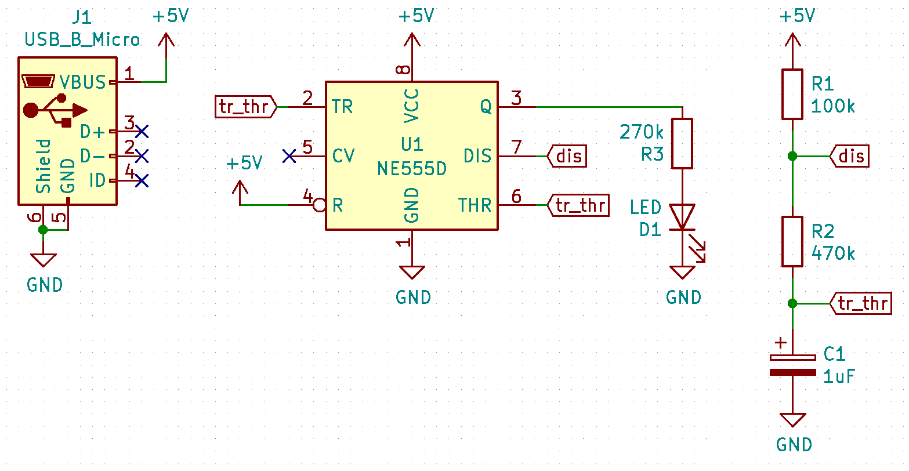

---

## 5. PCB Layout and Routing

### 5.1 Component Placement

The schematic was transferred to the KiCad PCB Editor, and the corresponding component footprints were placed within the PCB outline.

Component placement considered:

- Short timing-network connections.
- Accessible power input.
- Convenient LED placement.
- Adequate spacing between components.
- Practical routing and soldering requirements.

### 5.2 Track Routing

Copper tracks were routed to connect the component pads according to their assigned electrical nets.

The routing process considered track width, copper clearance, pad spacing, board-edge clearance, and manufacturing constraints.

### 5.3 Ground Copper Zone

A copper zone was assigned to the GND net to provide a common ground return path.

The copper zone was refilled after routing, and the resulting connections were inspected for isolated copper regions and unintended clearances.

### 5.4 PCB Layout Image

Insert your KiCad PCB Editor screenshot here.

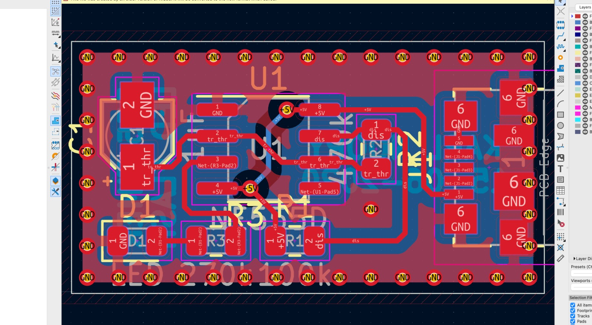

---

## 6. Three-Dimensional PCB Inspection

KiCad's 3D Viewer was used to inspect the physical arrangement of the PCB components.

The three-dimensional inspection helps verify:

- Component placement and orientation.
- Connector positioning.
- Package and footprint compatibility.
- Board geometry.
- General mechanical arrangement.

The 3D view represents the designed board and does not, by itself, confirm successful fabrication or electrical operation.

### 6.1 3D Board Render

Insert your KiCad 3D Viewer screenshot here.

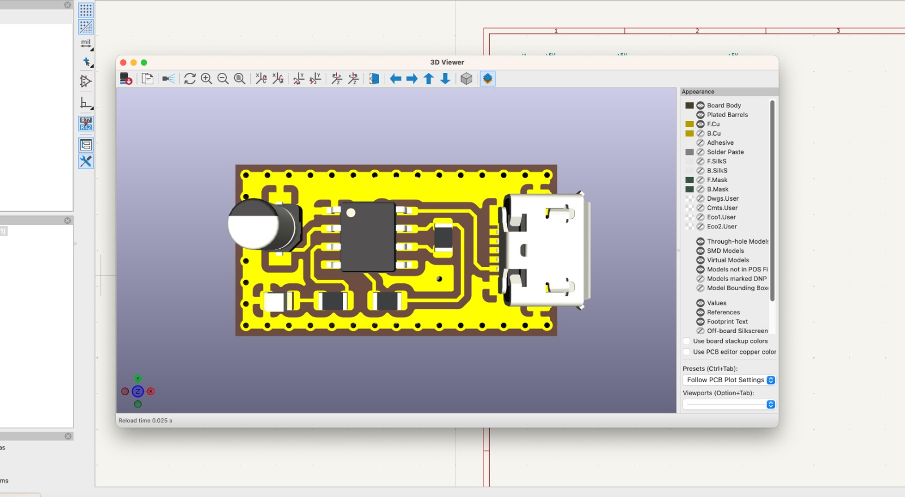

---

### 7.3 DRC Verification Image

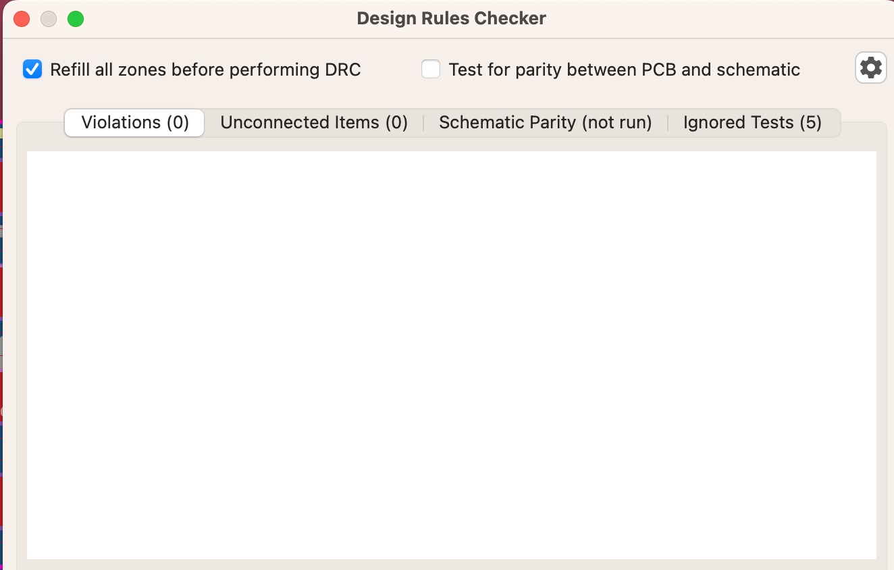

---

## 8. Functional Testing and Expected Results

### 8.1 Testing Procedure

After fabrication and assembly, the circuit can be tested using the following procedure:

1. Inspect the board for solder bridges and incorrectly oriented components.
2. Verify the power connector pinout and ground continuity.
3. Apply a regulated 5 V DC supply.
4. Measure the supply voltage across VCC and GND.
5. Observe the LED to confirm periodic flashing.
6. Measure the output waveform at pin 3 using an oscilloscope, if available.
7. Record the measured HIGH time, LOW time, and period.
8. Compare the measured results with the theoretical calculations.

### 8.2 Expected Results

| Parameter       |     Theoretical Value |
| --------------- | --------------------: |
| Supply voltage  |                5 V DC |
| HIGH time       |               0.395 s |
| LOW time        |               0.326 s |
| Total period    |               0.721 s |
| Frequency       | Approximately 1.39 Hz |
| HIGH duty cycle |   Approximately 54.8% |


---

---

## 10. Conclusion & Results Summary

The NE555 Astable Multivibrator LED Flasher project demonstrates the practical application of timing circuits and PCB design principles.

The circuit uses the charging and discharging of a timing capacitor to generate a periodic output waveform. With R1 = 100 kΩ, R2 = 470 kΩ, and C1 = 1 µF, the theoretical oscillation frequency is approximately 1.39 Hz, with a HIGH time of approximately 0.395 seconds and a LOW time of approximately 0.326 seconds.

KiCad provides a complete workflow for schematic capture, footprint assignment, PCB layout, track routing, ground copper filling, three-dimensional inspection, and design-rule verification.


# TASK 7- PCB REVOLUTION NE555 Astable Multivibrator LED Flasher PCB

## 1. Project Overview & Objectives

### 1.1 Project Overview

The NE555 Astable Multivibrator LED Flasher is an electronic circuit designed to generate a continuous sequence of HIGH and LOW output pulses using an NE555 timer integrated circuit.

The circuit operates in astable mode, in which the output continuously oscillates without requiring an external trigger for every cycle. The charging and discharging of a timing capacitor determine the oscillation frequency and duty cycle.

This project involves designing the circuit schematic, assigning component footprints, creating a PCB layout, routing electrical connections, applying copper fills, and verifying the design using KiCad.

### 1.2 Objectives

- Understand the operation of the NE555 timer in astable mode.
- Study capacitor charging and discharging through timing resistors.
- Prepare a Bill of Materials (BOM).
- Create the circuit schematic using KiCad.
- Design and route the PCB.
- Apply a ground copper zone.
- Perform schematic and PCB design-rule checks.
- Inspect the PCB using KiCad's 3D Viewer.
- Document the design and verification results.

### 1.3 Software and Tools

| Tool                   | Purpose                            |
| ---------------------- | ---------------------------------- |
| KiCad Schematic Editor | Schematic capture                  |
| KiCad PCB Editor       | PCB layout and routing             |
| KiCad 3D Viewer        | Three-dimensional board inspection |
| KiCad ERC              | Schematic electrical checks        |
| KiCad DRC              | PCB design-rule verification       |
| VS Code                | Markdown report preparation        |

---

## 2. Astable Circuit Theory

### 2.1 Operating Principle

The NE555 timer contains two comparators, an SR latch, a discharge transistor, and an output driver.

In astable mode, the timing capacitor C1 repeatedly charges and discharges between approximately one-third and two-thirds of the supply voltage.

**Charging phase:**

When the output is HIGH, the internal discharge transistor at pin 7 is OFF. Capacitor C1 charges through R1 and R2. When its voltage reaches approximately two-thirds of the supply voltage, the Threshold comparator changes the latch state and the output becomes LOW.

**Discharging phase:**

When the output is LOW, the internal discharge transistor turns ON. C1 discharges through R2 and the discharge transistor. When the capacitor voltage falls to approximately one-third of the supply voltage, the Trigger comparator changes the latch state and the output becomes HIGH again.

This cycle repeats continuously, producing a periodic output waveform that controls the LED.

---

## 3. Bill of Materials (BOM)

| Reference | Component           | Value / Type    | Quantity | Function                          |
| --------- | ------------------- | --------------- | -------: | --------------------------------- |
| U1        | NE555 timer IC      | SOIC-8 or DIP-8 |        1 | Generates the oscillating output  |
| R1        | Timing resistor     | 100 kΩ          |        1 | Controls charging time            |
| R2        | Timing resistor     | 470 kΩ          |        1 | Controls charging and discharging |
| R3        | LED resistor        | 270 Ω           |        1 | Limits LED current                |
| C1        | Timing capacitor    | 1 µF            |        1 | Determines oscillation timing     |
| D1        | Indicator LED       | Suitable LED    |        1 | Visual indication                 |
| J1        | Micro-USB connector | 5 V input       |        1 | Supplies circuit power            |

The selected component footprints must match the actual components used during assembly. The NE555 package, LED polarity, and Micro-USB pinout must be verified before fabrication.

A 100 nF supply-decoupling capacitor placed close to U1 is also recommended.

---

## 4. KiCad Schematic Design

### 4.1 Schematic Capture

The circuit schematic was prepared in KiCad by placing the NE555 timer, resistors, timing capacitor, LED, and power connector.

The components were interconnected according to the conventional NE555 astable configuration.

Important connections include:

- Pin 1 to GND.
- Pin 8 to the positive supply.
- Pin 4 (RESET) held HIGH.
- Pins 2 (TRIG) and 6 (THRES) connected to the timing-capacitor node.
- Pin 7 (DISCH) connected to the timing-resistor junction.
- Pin 3 (OUT) connected to the LED branch.

The schematic was reviewed to ensure that the component connections matched the intended circuit topology.

### 4.2 Schematic Capture Image

Insert your KiCad schematic screenshot here.


---

## 5. PCB Layout and Routing

### 5.1 Component Placement

The schematic was transferred to the KiCad PCB Editor, and the corresponding component footprints were placed within the PCB outline.

Component placement considered:

- Short timing-network connections.
- Accessible power input.
- Convenient LED placement.
- Adequate spacing between components.
- Practical routing and soldering requirements.

### 5.2 Track Routing

Copper tracks were routed to connect the component pads according to their assigned electrical nets.

The routing process considered track width, copper clearance, pad spacing, board-edge clearance, and manufacturing constraints.

### 5.3 Ground Copper Zone

A copper zone was assigned to the GND net to provide a common ground return path.

The copper zone was refilled after routing, and the resulting connections were inspected for isolated copper regions and unintended clearances.

### 5.4 PCB Layout Image

Insert your KiCad PCB Editor screenshot here.


---

## 6. Three-Dimensional PCB Inspection

KiCad's 3D Viewer was used to inspect the physical arrangement of the PCB components.

The three-dimensional inspection helps verify:

- Component placement and orientation.
- Connector positioning.
- Package and footprint compatibility.
- Board geometry.
- General mechanical arrangement.

The 3D view represents the designed board and does not, by itself, confirm successful fabrication or electrical operation.

### 6.1 3D Board Render

Insert your KiCad 3D Viewer screenshot here.


---

### 7.3 DRC Verification Image


---

## 8. Functional Testing and Expected Results

### 8.1 Testing Procedure

After fabrication and assembly, the circuit can be tested using the following procedure:

1. Inspect the board for solder bridges and incorrectly oriented components.
2. Verify the power connector pinout and ground continuity.
3. Apply a regulated 5 V DC supply.
4. Measure the supply voltage across VCC and GND.
5. Observe the LED to confirm periodic flashing.
6. Measure the output waveform at pin 3 using an oscilloscope, if available.
7. Record the measured HIGH time, LOW time, and period.
8. Compare the measured results with the theoretical calculations.

### 8.2 Expected Results

| Parameter       |     Theoretical Value |
| --------------- | --------------------: |
| Supply voltage  |                5 V DC |
| HIGH time       |               0.395 s |
| LOW time        |               0.326 s |
| Total period    |               0.721 s |
| Frequency       | Approximately 1.39 Hz |
| HIGH duty cycle |   Approximately 54.8% |


---

---

## 10. Conclusion & Results Summary

The NE555 Astable Multivibrator LED Flasher project demonstrates the practical application of timing circuits and PCB design principles.

The circuit uses the charging and discharging of a timing capacitor to generate a periodic output waveform. With R1 = 100 kΩ, R2 = 470 kΩ, and C1 = 1 µF, the theoretical oscillation frequency is approximately 1.39 Hz, with a HIGH time of approximately 0.395 seconds and a LOW time of approximately 0.326 seconds.

KiCad provides a complete workflow for schematic capture, footprint assignment, PCB layout, track routing, ground copper filling, three-dimensional inspection, and design-rule verification.


# Task 9: Combinational Logic Design using PAL and PLA


**Platform:** Logisim Evolution

---

## 1. Aim

To understand and implement combinational logic using PAL and PLA structures. A 3-bit odd parity circuit is designed with both a PAL and a PLA. A smart home light controller is then designed using a PLA.

## 2. Objectives

- Understand PROM, PAL and PLA and the key differences between them.
- Design a circuit that outputs 1 when the number of 1s in a 3-bit input is odd.
- Draw the fuse tables of the AND array and the OR array, showing intact and blown fuses.
- Design a smart home controller for three lights and justify the choice of PLA or PAL.

## 3. Theory

### 3.1 Sum of products

Any combinational logic function can be written as a **sum of products**: some AND terms (product terms) joined by OR. A programmable logic device builds this with two blocks:

- An **AND array** that makes the product terms.
- An **OR array** that adds the product terms together to form the outputs.

The difference between PROM, PAL and PLA is which of these two arrays can be programmed.

### 3.2 PROM, PAL and PLA

- **PROM (Programmable Read Only Memory):** the AND array is fixed and acts as a decoder that produces every minterm (2^n lines for n inputs). The OR array is programmable and selects which minterms go to each output. It can build any function, but its size doubles with every extra input.
- **PAL (Programmable Array Logic):** the AND array is programmable, and the OR array is fixed. Each output has its own fixed OR gate, so a product term cannot be shared between outputs.
- **PLA (Programmable Logic Array):** both the AND array and the OR array are programmable. Any product term can be used by any output, so terms can be shared.

| Feature | PROM | PAL | PLA |
|---|---|---|---|
| AND array | Fixed | Programmable | Programmable |
| OR array | Programmable | Fixed | Programmable |
| Flexibility | Any function, but needs 2^n lines | Medium | Highest |
| Sharing a product term between outputs | Not applicable (all minterms are available) | Not possible | Possible |
| Cost and speed | Large for many inputs | Cheaper and faster | More complex and slightly slower |

### 3.3 Fuse tables and fuse diagrams

A fuse table (or fuse diagram) shows which connections in an array are kept and which are removed.

- **X** (or ✕ in the diagrams) means the fuse is **intact** (the connection is kept).
- **–** (or a red ○ in the diagrams) means the fuse is **blown** (the connection is removed).
- **■** in the diagrams means a **fixed** connection that cannot be changed (the PAL's OR array).


---

## 4. Part A: Odd Parity Circuit (3-bit)

### 4.1 Problem

Design a circuit with inputs A, B and C that gives output F = 1 when the number of 1s in the input is **odd**.

### 4.2 Truth table

| A | B | C | Number of 1s | F |
|---|---|---|---|---|
| 0 | 0 | 0 | 0 | 0 |
| 0 | 0 | 1 | 1 | 1 |
| 0 | 1 | 0 | 1 | 1 |
| 0 | 1 | 1 | 2 | 0 |
| 1 | 0 | 0 | 1 | 1 |
| 1 | 0 | 1 | 2 | 0 |
| 1 | 1 | 0 | 2 | 0 |
| 1 | 1 | 1 | 3 | 1 |


### 4.3 Boolean expression

```
F = A'·B'·C + A'·B·C' + A·B'·C' + A·B·C
```


**K-map**

| A \ BC | 00 | 01 | 11 | 10 |
|---|---|---|---|---|
| 0 | 0 | 1 | 0 | 1 |
| 1 | 1 | 0 | 1 | 0 |


### 4.4 Design using a PAL

In a PAL, the AND array is programmable and the OR array is fixed. The four product terms are:

```
P1 = A'·B'·C
P2 = A'·B·C'
P3 = A·B'·C'
P4 = A·B·C
```

**AND array fuse table (programmable)**

| Product term | A | A' | B | B' | C | C' |
|---|---|---|---|---|---|---|
| P1 = A'·B'·C | – | X | – | X | X | – |
| P2 = A'·B·C' | – | X | X | – | – | X |
| P3 = A·B'·C' | X | – | – | X | – | X |
| P4 = A·B·C | X | – | X | – | X | – |

Intact fuses: 12. Blown fuses: 12. (4 product terms with 6 fuses each is 24 fuses in total, and each product term keeps 3 of them.)

**OR array (fixed, cannot be programmed)**

| Output | P1 | P2 | P3 | P4 |
|---|---|---|---|---|
| F | fixed | fixed | fixed | fixed |

All four product terms are permanently connected to the OR gate, so `F = P1 + P2 + P3 + P4`.

**Fuse diagram of the PAL**

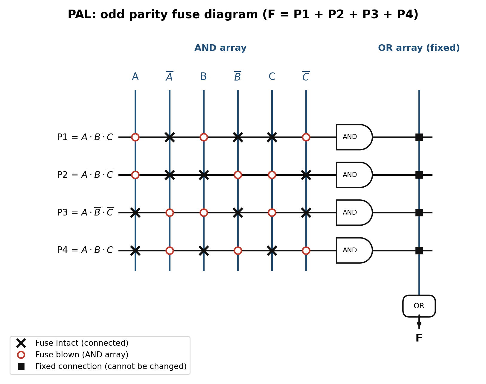


<!-- Optional: your own fuse drawing for the PAL. Delete the markers around the next line and put your file name in it.

-->

**Logisim circuit of the PAL**

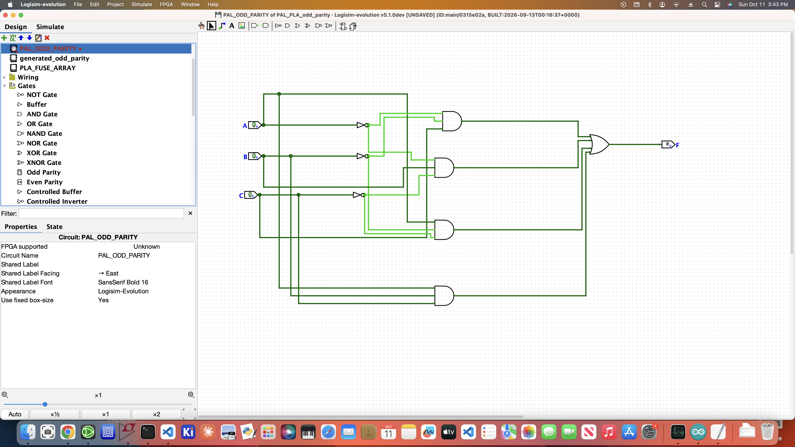


### 4.5 Design using a PLA

In a PLA, both arrays are programmable. The AND array is the same as in the PAL.

**AND array fuse table (programmable)**

| Product term | A | A' | B | B' | C | C' |
|---|---|---|---|---|---|---|
| P1 = A'·B'·C | – | X | – | X | X | – |
| P2 = A'·B·C' | – | X | X | – | – | X |
| P3 = A·B'·C' | X | – | – | X | – | X |
| P4 = A·B·C | X | – | X | – | X | – |

**OR array fuse table (programmable)**

| Output | P1 | P2 | P3 | P4 |
|---|---|---|---|---|
| F | X | X | X | X |

Intact fuses: 4. Blown fuses: 0. All four product terms are needed, so no fuse in the OR array is blown. If a product term were not needed, its fuse would be blown to leave it out of the output.

**Fuse diagram of the PLA**

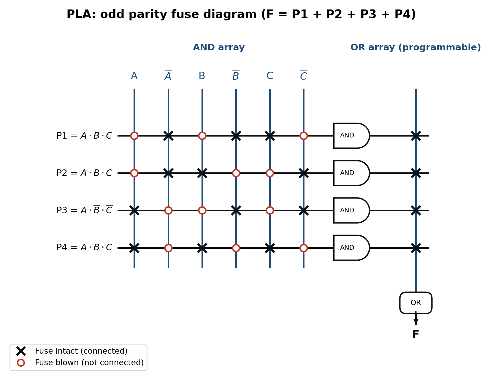


<!-- Optional: your own fuse drawing for the PLA (for example a screenshot of your PLA_FUSE_ARRAY circuit). Delete the markers around the next line and put your file name in it.

-->

**Logisim circuit of the PLA**

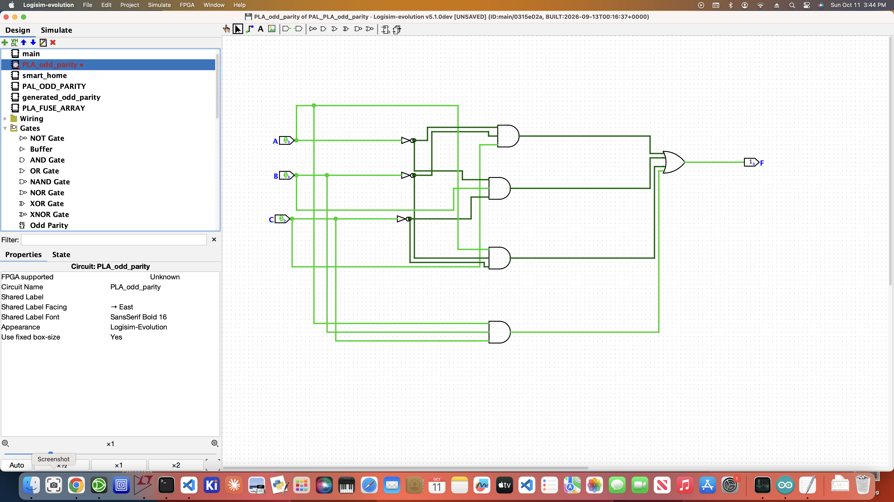


### 4.6 For comparison: the same function in a PROM

A PROM has a fixed AND array that makes all 8 minterms. Only the OR array is programmed.

| Output | m0 | m1 | m2 | m3 | m4 | m5 | m6 | m7 |
|---|---|---|---|---|---|---|---|---|
| F | – | X | X | – | X | – | – | X |

A PROM needs 8 lines for this function, but the PAL and the PLA need only 4 product terms. This is why PAL and PLA are more efficient for functions with few product terms.

### 4. Verification


| A | B | C | Expected F |
|---|---|---|---|
| 0 | 0 | 0 | 0 |
| 0 | 0 | 1 | 1 |
| 0 | 1 | 0 | 1 |
| 0 | 1 | 1 | 0 |
| 1 | 0 | 0 | 1 |
| 1 | 0 | 1 | 0 |
| 1 | 1 | 0 | 0 |
| 1 | 1 | 1 | 1 |


### 4.7 PAL and PLA for this function

The PAL and PLA circuits are identical at gate level here, because there is only one output and it needs all four product terms. The difference is in the arrays: the PAL's OR array is fixed, and the PLA's OR array is programmable. For a single output the PLA has no advantage. The benefit of a PLA appears when several outputs can share product terms, as in Part B.

---

## 5. Part B: Smart Home Light Controller (PLA)

### 5.1 Problem

Design a controller for three lights using four inputs: a motion sensor (M), a light level sensor (L), the time of day (T) and a manual override (O). The task does not fix the rules, so the following rules were chosen for the design.

### 5.2 Inputs and outputs

| Name | Type | Meaning when it is 1 |
|---|---|---|
| M | Input | Motion detected |
| L | Input | Room is dark (low light level) |
| T | Input | It is night time |
| O | Input | Manual override is ON |
| L1 | Output | Light 1 is ON |
| L2 | Output | Light 2 is ON |
| L3 | Output | Light 3 is ON |


### 5.3 Rules

| Light | It turns ON when |
|---|---|
| Light 1 (L1) | There is motion AND the room is dark, OR the override is ON |
| Light 2 (L2) | There is motion AND the room is dark AND it is night, OR the override is ON |
| Light 3 (L3) | There is motion AND it is night, OR the override is ON |

When the manual override is ON, all three lights turn on, whatever the sensors say.

### 5.4 Boolean equations

```
L1 = M·L + O
L2 = M·L·T + O
L3 = M·T + O
```

### 5.5 Truth table

| M | L | T | O | L1 | L2 | L3 |
|---|---|---|---|---|---|---|
| 0 | 0 | 0 | 0 | 0 | 0 | 0 |
| 0 | 0 | 0 | 1 | 1 | 1 | 1 |
| 0 | 0 | 1 | 0 | 0 | 0 | 0 |
| 0 | 0 | 1 | 1 | 1 | 1 | 1 |
| 0 | 1 | 0 | 0 | 0 | 0 | 0 |
| 0 | 1 | 0 | 1 | 1 | 1 | 1 |
| 0 | 1 | 1 | 0 | 0 | 0 | 0 |
| 0 | 1 | 1 | 1 | 1 | 1 | 1 |
| 1 | 0 | 0 | 0 | 0 | 0 | 0 |
| 1 | 0 | 0 | 1 | 1 | 1 | 1 |
| 1 | 0 | 1 | 0 | 0 | 0 | 1 |
| 1 | 0 | 1 | 1 | 1 | 1 | 1 |
| 1 | 1 | 0 | 0 | 1 | 0 | 0 |
| 1 | 1 | 0 | 1 | 1 | 1 | 1 |
| 1 | 1 | 1 | 0 | 1 | 1 | 1 |
| 1 | 1 | 1 | 1 | 1 | 1 | 1 |

### 5.6 Product terms

Four distinct product terms are needed:

```
P1 = M·L
P2 = M·L·T
P3 = M·T
P4 = O
```

The outputs are then:

```
L1 = P1 + P4
L2 = P2 + P4
L3 = P3 + P4
```

### 5.7 Choice of PLA, with justification

A **PLA** was chosen for this design.

- **Shared product term.** The override O is used by all three lights. In a PLA, the single product term P4 = O can be shared, so the whole design needs only **4 product terms**.
- **A PAL cannot share.** Each PAL output has its own fixed OR gate, so the term O would have to be repeated in every output. The design would then need **6 product terms** (3 for the sensor conditions and 3 copies of O).
- **Easy to change.** If a fourth light that also follows the override were added, a PLA could reuse P4 with one more fuse, instead of using up another product term.
- **Trade-off.** A PLA is slightly more complex and a little slower than a PAL, because both of its arrays are programmable. For a small, slow system like a light controller, this does not matter.

### 5.8 Fuse tables and fuse diagram

**AND array (programmable)**

| Product term | M | M' | L | L' | T | T' | O | O' |
|---|---|---|---|---|---|---|---|---|
| P1 = M·L | X | – | X | – | – | – | – | – |
| P2 = M·L·T | X | – | X | – | X | – | – | – |
| P3 = M·T | X | – | – | – | X | – | – | – |
| P4 = O | – | – | – | – | – | – | X | – |


**OR array (programmable)**

| Output | P1 | P2 | P3 | P4 |
|---|---|---|---|---|
| L1 | X | – | – | X |
| L2 | – | X | – | X |
| L3 | – | – | X | X |


**Fuse diagram of the smart home PLA**

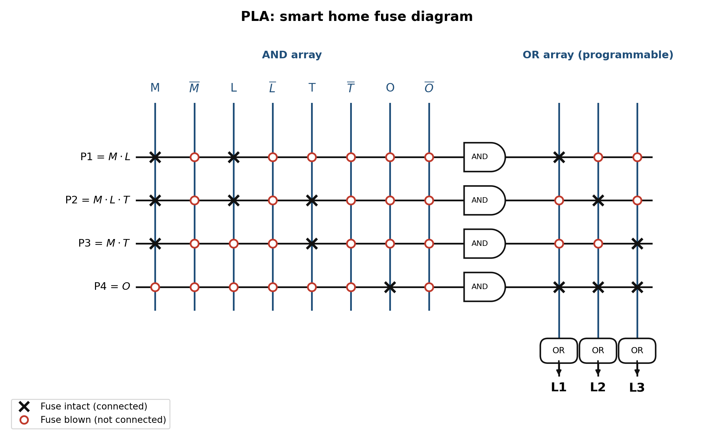


### 5.9 Circuit

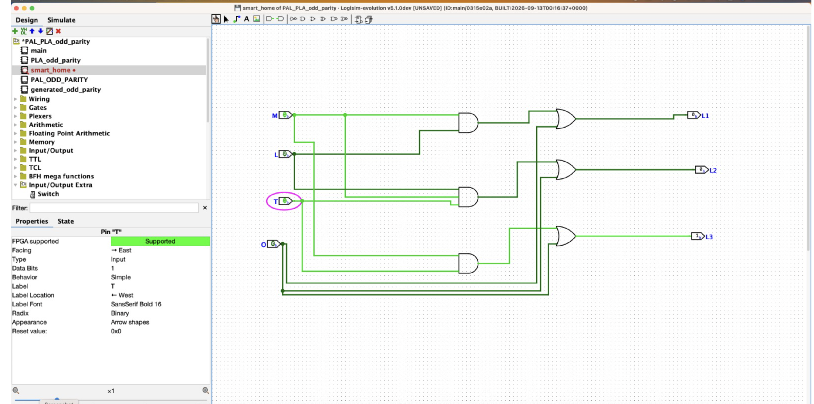


The circuit has four AND gates (P1 to P4, where P4 is the O input going straight through) and three OR gates, one for each light. The override O goes into all three OR gates. The AND gates make M·L, M·L·T and M·T.


---

## 6. Summary of Results

| Design | Method | Product terms | Result |
|---|---|---|---|
| Odd parity | PAL | 4 | Matches the truth table |
| Odd parity | PLA | 4 | Matches the truth table |
| Smart home controller | PLA | 4 (3 for the sensors and 1 shared for the override) | Matches the truth table |


## 7. Conclusion

A 3-bit odd parity circuit was designed using both a PAL and a PLA. Its function F = Σm(1, 2, 4, 7) cannot be simplified, so both designs needed four product terms, and they differ only in which array is programmable. A smart home light controller was then designed with a PLA. Because the manual override is used by all three lights, the PLA could share that one product term, which gave 4 product terms instead of the 6 a PAL would need. The fuse tables and fuse diagrams show which connections are kept and which are blown in each array.

## 8. References

- Programmable Array Logic: https://www.geeksforgeeks.org/programming-array-logic/
- Programmable Logic Array: https://www.geeksforgeeks.org/programmable-logic-array/
- Logisim Evolution: https://github.com/logisim-evolution/logisim-evolution/releases


# Task 10: Your Logic, Preloaded


**Platform:** CircuitVerse  

---

## 1. Aim

To understand the concept of Look-Up Tables (LUTs) in digital electronics and implement a 2-input XOR function using a 4 × 1 LUT in CircuitVerse.

## 2. Objectives

- Understand the concept and working principle of Look-Up Tables.
- Study how input combinations select stored output values.
- Construct the truth table for a 2-input XOR function.
- Implement a 4 × 1 LUT using CircuitVerse.
- Assign the correct output values to the four LUT entries.
- Simulate different input combinations and verify the output.
- Understand the use of LUTs in digital logic design and programmable logic devices.

## 3. Tools and Resources Used

| Item      | Details                                                         |
| --------- | --------------------------------------------------------------- |
| Platform  | CircuitVerse                                                    |
| Software  | Online digital logic circuit simulator                          |
| Circuit   | 4 × 1 Look-Up Table                                             |
| Inputs    | Two binary inputs, A and B                                      |
| Output    | One binary output, Y                                            |
| Function  | 2-input XOR                                                     |
| Resources | All About Circuits LUT tutorial and the provided video resource |


---

## 4. Theory

### 4.1 Look-Up Table (LUT)

A Look-Up Table is a digital logic structure that stores predefined output values for different input combinations. Instead of calculating the output using a network of logic gates, the circuit uses its inputs to select the corresponding stored value.

A LUT can be used to implement Boolean functions and is an important concept in programmable digital logic devices, including Field-Programmable Gate Arrays (FPGAs).

For a LUT with _n_ input bits, the total number of possible input combinations is:

**Number of entries = 2^n**

For two input bits:

**Number of entries = 2^2 = 4**

Therefore, a 2-input LUT requires four stored output values.

### 4.2 Working Principle of a 4 × 1 LUT

A 4 × 1 LUT has four stored entries and one output. Two input bits select one of the four entries.

| Input A | Input B | Selected Entry | Output          |
| ------- | ------- | -------------- | --------------- |
| 0       | 0       | Entry 0        | Stored value D0 |
| 0       | 1       | Entry 1        | Stored value D1 |
| 1       | 0       | Entry 2        | Stored value D2 |
| 1       | 1       | Entry 3        | Stored value D3 |

Here, A and B act as selection inputs, while D0, D1, D2 and D3 are the values stored in the LUT.

The stored values depend on the Boolean function being implemented.

### 4.3 XOR Logic Function

XOR stands for Exclusive OR. Its output is HIGH (1) when the two input bits are different and LOW (0) when both input bits are the same.

The Boolean expression for XOR is:

**Y = A XOR B**

It can also be expressed using AND, OR and NOT operations:

**Y = (NOT A AND B) OR (A AND NOT B)**

### 4.4 XOR Truth Table

The truth table for a 2-input XOR function is shown below.

| A   | B   | Y = A XOR B |
| --- | --- | ----------- |
| 0   | 0   | 0           |
| 0   | 1   | 1           |
| 1   | 0   | 1           |
| 1   | 1   | 0           |

From the truth table, the output sequence for input combinations 00, 01, 10 and 11 is:

**0, 1, 1, 0**

Therefore, the LUT must be programmed with the following values:

**D0 = 0, D1 = 1, D2 = 1, D3 = 0**

These stored values reproduce the XOR function.

---

## 5. Procedure

### 5.1 Understanding the LUT

1. Studied the basic concept of a Look-Up Table and its use in digital logic.
2. Identified that two binary inputs produce four possible input combinations.
3. Understood that each input combination selects one of the four stored LUT entries.
4. Determined that four output values are required to implement the 2-input XOR function.

### 5.2 Creating the XOR Truth Table

1. Identified the two input variables, A and B.
2. Listed all possible combinations: 00, 01, 10 and 11.
3. Evaluated the XOR output for each combination.
4. Recorded the output sequence as 0, 1, 1 and 0.

### 5.3 Programming the 4 × 1 LUT

1. Opened CircuitVerse and created a new circuit.
2. Added two binary input signals, A and B.
3. Added the components required to represent a 4 × 1 LUT.
4. Connected A and B to the LUT selection inputs.
5. Assigned the stored values according to the XOR truth table:
   - **D0 = 0**
   - **D1 = 1**
   - **D2 = 1**
   - **D3 = 0**
6. Connected the selected LUT output to an output indicator.
7. Checked the circuit connections to ensure the inputs selected the intended entries.

### 5.4 Simulating the LUT

1. Set A = 0 and B = 0 and checked that the output was 0.
2. Set A = 0 and B = 1 and checked that the output was 1.
3. Set A = 1 and B = 0 and checked that the output was 1.
4. Set A = 1 and B = 1 and checked that the output was 0.
5. Compared the observed outputs with the XOR truth table.


---

## 6. Circuit Implementation

The circuit uses two binary inputs to select one of four stored output values. The four LUT entries are programmed according to the XOR truth table, and the selected value is connected to a single output indicator.

### 6.1 Circuit Diagram

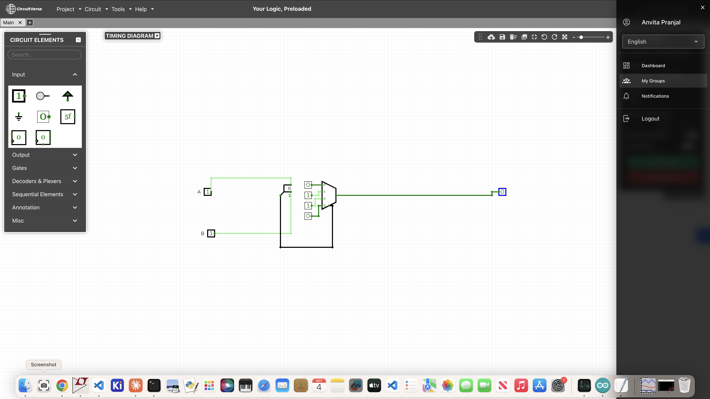


### 6.2 LUT Configuration

| LUT Entry | Input A | Input B | Stored Output |
| --------- | ------- | ------- | ------------- |
| D0        | 0       | 0       | 0             |
| D1        | 0       | 1       | 1             |
| D2        | 1       | 0       | 1             |
| D3        | 1       | 1       | 0             |

The LUT configuration stores the correct XOR output for each possible input combination.

### 6.3 Input Selection

The two input bits select the corresponding LUT entry as follows:

- **AB = 00:** Selects D0, producing output 0.
- **AB = 01:** Selects D1, producing output 1.
- **AB = 10:** Selects D2, producing output 1.
- **AB = 11:** Selects D3, producing output 0.

Thus, the LUT reproduces the expected XOR truth table when the entries and selection connections are configured correctly.

---

## 7. Results and Verification

The required LUT configuration for the XOR function is:

| Test Case | A   | B   | Expected Output | Verification    |
| --------- | --- | --- | --------------- | --------------- |
| 1         | 0   | 0   | 0               | To be confirmed |
| 2         | 0   | 1   | 1               | To be confirmed |
| 3         | 1   | 0   | 1               | To be confirmed |
| 4         | 1   | 1   | 0               | To be confirmed |

The expected output sequence is **0, 1, 1, 0**, matching the truth table of the XOR function.


---

## 8. Conclusion

This task introduces the concept of Look-Up Tables in digital electronics and demonstrates how a 2-input XOR function can be represented using a 4 × 1 LUT. By constructing the truth table and assigning the stored values D0 = 0, D1 = 1, D2 = 1 and D3 = 0, the required XOR function can be implemented through input-based selection.


---

## 9. References

1. All About Circuits, _Look-Up Tables_: https://www.allaboutcircuits.com/textbook/digital/chpt-16/look-up-tables/
2. CircuitVerse, _Digital Logic Circuit Simulator_: https://circuitverse.org/
